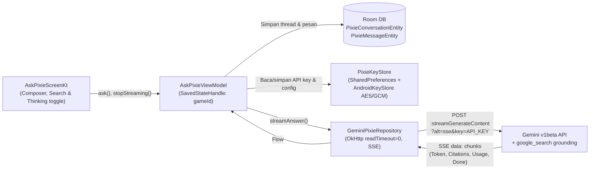

# Analisis Statis PixelGuide v1.5 — Sistem AI, ML & Perbandingan dengan GameGuideGo

> **Tanggal analisis:** 2026-11-24  
> **Target APK:** `app.nanostack.pixelguide` v1.5 (`versionCode 19`, `minSdk 26`, `targetSdk 36`)  
> **SHA-256 APK:** `07a5e4ef2a8a94a14933ef78626c7e344aa28a47e83c8fe116129aa0a552b7ff`  
> **Lokasi file lokal saat analisis:** `/Users/ryan.setiawan/.gemini/antigravity-cli/brain/50c8f3d8-4bcc-40ef-9125-2b7fc68041f8/scratch/pixelguide-v1.5.apk`  
> **Mesin dekompilasi:** REA `6.7.0` + `jadx-headless-mcp-0.7.1-all.jar` (`rea-jadx-bridge` v4, Java `21.0.8`)  
> **Sifat analisis:** Read-only statis (tanpa eksekusi APK, tanpa panggilan API live).

---

## 1. Ringkasan Eksekutif

- **Hanya ada dua sistem AI/ML di PixelGuide v1.5** (`ev_e0e1b4198b59d3802a02b7fec102270a2696e6a9a1a39ba6e71ae2138c4b5b33`, `ev_617763ea541b538e10918f46d3a8ed83cd0156f2a807f06e2f997dc05b09d044`, `ev_dec43f35829b70be9c2ccf3c6d02a65883c8c13b32217bcd0c9cf392ed026931`, `ev_13183a58328298ee5b222dd044220529001de1627e2f52a5c7d483e33c8e86f5`):
  1. **Pixie AI:** asisten tanya-jawab berbasis **Gemini REST API (`v1beta`)** dengan pola **BYOK** (*Bring Your Own Key*) yang dieksekusi langsung dari perangkat pengguna.
  2. **Translate Guide:** deteksi bahasa dan penerjemahan file guide lokal **100% on-device / offline** berbasis **Google ML Kit** (`languageid` bundled + `nl.translate`).
- **Pixie AI 100% terisolasi dari guide lokal pengguna:** hasil `trace_android_references` dan dekompilasi `buildRequestBody` membuktikan Pixie **tidak pernah** mengakses `GuideEntity`, `GuideStorageRepository`, halaman/posisi reader, `AnnotationDao`, maupun `RetroAchievementDao`. Konteks yang dikirim ke Gemini hanya `game.title`, `game.releaseYear` (opsional), maksimal 8 pesan history terakhir, dan `google_search` grounding. Bahkan `GameEntity.platforms` tidak ikut dikirim.
- **Posisi kompetitif terhadap GameGuideGo:**
  - **Observasi + Inferensi:** Untuk kapabilitas *AI game companion*, **GameGuideGo jauh lebih kuat** karena memiliki Hybrid RAG atas guide pilihan user, kesadaran platform/progres, proteksi spoiler 2-pass, input gambar (Vision) + visual reference lookup, voice input, edit/retry, temporary chat, server `after()` persistence, serta zero-setup tanpa API key.
  - **Observasi + Inferensi:** Sebaliknya, **PixelGuide unggul pada ekosistem *offline retro guide & map reader*** (multi-format TXT/HTML/PDF/CBZ/XLSX/tiled map, auto-TOC TXT GameFAQs, ad-blocking scraper multi-situs, canvas anotasi di atas peta/guide, terjemahan offline gratis, integrasi RetroAchievements, dan kontrol analog-stick untuk handheld Android).

> **Catatan Metodologi Eksekusi:** Di lingkungan Antigravity, konfigurasi MCP di `.agents/mcp_config.json` tidak di-mount otomatis sebagai MCP global. Sesuai prosedur fallback pada skill `reverse-engineer-anything`, seluruh inspeksi dan dekompilasi dijalankan melalui **CLI REA `6.7.0`** (`rea.mjs`) yang menggerakkan JAR `jadx-headless-mcp-0.7.1-all.jar` yang sama (bukan `dexdump`). Setiap klaim di bawah ini membedakan secara tegas **Observasi Statis** (fakta bytecode/manifest/dekompilasi JADX) dan **Inferensi** (interpretasi perilaku runtime atau rekomendasi produk).

---

## 2. Indeks Evidence REA/JADX

> **Batasan statis (berlaku untuk seluruh Evidence di bawah):** Analisis statis JADX tidak menjalankan aplikasi; perilaku runtime, nilai dinamis, pemanggilan reflektif, atau cabang yang bergantung pada respons server live tidak dieksekusi.

| Operasi REA | Target | Cakupan / Catatan | Evidence ID |
|---|---|---|---|
| `inspect_android_package` | `pixelguide-v1.5.apk` | Manifest, permissions, 23.482 kelas, 734 resource | `ev_e0e1b4198b59d3802a02b7fec102270a2696e6a9a1a39ba6e71ae2138c4b5b33` |
| `search_android_classes` | Query `"app.nanostack.pixelguide"` | 824 kelas (coverage: `complete`) | `ev_d2d7ceecceaa756988db589a95946ed068478f35bd881e632f26f6412788f5a9` |
| `search_android_classes` | Query `"mlkit"` | 1.546 kelas dalam 16 package ML Kit | `ev_617763ea541b538e10918f46d3a8ed83cd0156f2a807f06e2f997dc05b09d044` |
| `search_android_classes` | Query `"ai"` | Scan library AI/ML lain di seluruh APK | `ev_dec43f35829b70be9c2ccf3c6d02a65883c8c13b32217bcd0c9cf392ed026931` |
| `inspect_android_class` | `GeminiPixieRepository` | Inventori field & method | `ev_644bef276b9fb2fbd22204147d3560a611e926c47c1a43eda3394f7d972d96ac` |
| `inspect_android_class` | `PixieKeyStore` | Inventori field & method | `ev_af2ebe0543b04795adac416455e61d80e453d8bdb530b10d02e592e2311de9df` |
| `inspect_android_class` | `PixieThinkingLevel` | Inventori enum & `Companion` | `ev_52d6d89ccbdaf377d81184c2140bc34f547b9d010e1e3e24fd5c792a89176b17` |
| `inspect_android_class` | `AskPixieViewModel` | Inventori field & 51 method non-sintetik | `ev_495203cfefba03f61690c81208cec32673d316abf0f1f5cb4f9abc6ae638f20a` |
| `inspect_android_class` | `AskPixieScreenKt` | Inventori field biaya & 93 method UI | `ev_7f03b3c00bef64a64b91be043ea165d4863b286a0602d7680bc7aaf095d81e06` |
| `inspect_android_class` | `TranslateGuideViewModel` | Inventori field & 32 method non-sintetik | `ev_751836cf32ae3888394078af84fa9e7689302a46211875b1ee19f5aabf66e4b2` |
| `inspect_android_class` | `PixieMessageDao`, `PixieMessageEntity`, `PixieConversationEntity` | Skema Room DB untuk thread & pesan Pixie | `ev_761c2808e256911124792cd623ebee3ed32375344fb7954f0c1c8c36f3560499`, `ev_01c937a7ce2c8b88a233962ce6b95837067dae8c4be1cdd4cfe8695694b7af06`, `ev_22d45d6aa70501f17c69e18e1d94e60122904dc64e057d8c0e9d2f0313f955c3` |
| `inspect_android_class` | `GameEntity`, `FeatureToggles` | Metadata game & flag fitur APK | `ev_ae7734f0bff5d0dd417ba410fde1c16440794188da77e4de65e70a7c600c92f8`, `ev_13183a58328298ee5b222dd044220529001de1627e2f52a5c7d483e33c8e86f5` |
| `trace_android_references` | `GeminiPixieRepository`, `AskPixieViewModel` | Pemanggil & dependensi masuk Pixie | `ev_9b69e784e121356794b834247337289a049046a7e2d20f2a86e00664c629a0c8`, `ev_c4fdef2826bf139183357e7a1cebeea65a273572d02285cd0e4dab54dec78f44` |
| `trace_android_references` | `GuideStorageRepository`, `GuideEntity`, `AnnotationDao`, `RetroAchievementDao` | Verifikasi isolasi data lokal dari Pixie | `ev_d0bae61a825b31552cb5ce85890c73073022cbb71e542b167b2a6188b51fbc12`, `ev_90964ed3a7b5ff739e27e33d4ca423e7b69badf9445cf70ef1c434bfbc84601e`, `ev_96b61d89782f8fd7b9d525acb12f432e5d73a420bfd9c7cadae84abf852ecce5`, `ev_21e0226a611490f53a60933df9bc649d157762198d14cf4a543fa482933db185` |
| `inspect_android_method` | `GeminiPixieRepository` (`<init>`, `streamAnswer`, `$streamAnswer$1`, `$job$1`, `buildRequestBody`, `thinkingConfigFor`, `toGemini25ThinkingBudget`, `toGemini3ThinkingLevel`, `extractCitations`, `parseError`, `processSsePayload`, `cleanModelName`, `WhenMappings.<clinit>`) | Body lengkap Java/Smali seluruh pipeline Gemini | `ev_6ba3b091903a5afe4e057339fa9878e6198c85d1998002a9d419a56b8cc83bff`, `ev_1816c706ff28ffa87ddd4d8e6982ae0ea6847b30019bf91249b3f3cd918dba76`, `ev_3eaedd2e5d9073cc21d0ce1d311a7b68d4fef0ba3c669d12cbab1c00cba6ad5e`, `ev_c521493c84a6d33f1b9ff7b0df4dcd700ff70ce2b42622fa7614788807458657`, `ev_3e0e1e7b7b27b05fa9954aadb43dbba228cd1c8fe31d92d6e540def76185e071`, `ev_60b152b1ef1709b029a4bb4822053479e5939ff559d7e76d8fac644efa6e899e`, `ev_8c047a0b89a5116a9e8ba97b22c00ebda145111cddd2d8a7700cc59de591b762`, `ev_867dd241c89763772ff6bf75259e11e756900a30f2062ceaa646910850612736`, `ev_b7236209a27ccb4d9d0525db6953743d91eba86b87fdc7eafbf8a2bacdb03f46`, `ev_638f8ab2e7842edaba2295fd76c47752184568ec7f96717e2cea3c71f8b224ce`, `ev_0f169702e0a2f587de60ea859a0a43ddc23d80c4315486e76208b199981b1e23`, `ev_b7a2ead801bef3e3a99413e98665b33c90d6606b6b725ab91303e47409a3f6e6`, `ev_9007f8b0a9a18ef25268266d77140c724a8ae2b4037036355d93fa041f5b06e1` |
| `inspect_android_method` | `AppModule.provideOkHttpClient`, `PixieKeyStore` (`<clinit>`, `<init>`, `loadConfig`, `saveModel`, `saveApiKey`, `loadApiKey`, `getOrCreateSecretKey`, `Companion.normalizeModel`), `PixieThinkingLevel` (`<clinit>`, `Companion.fromStoredValue`) | OkHttp config, AES/GCM KeyStore, model migration | `ev_3d3860cbcf8953442019b5b59fd719de59eda138db3b9e53c75cbf2a5a510e3d`, `ev_876c9607321644f3d9718664592d730cdee3c1de34b2c0dd8182acf5e41092cc`, `ev_184d68ea6686b8468e05772883bcb1803bc8db39ecad83e9ced8a89932087c26`, `ev_4ff3455f06a420befa7e45cd5e2bac3b4dbe079bf48467d6fda64adeba9b9d23`, `ev_0332032afba3cd5677485bda184cdaf0c1dd74fcef92873d380d7f285f441328`, `ev_f6b814c4387c7f591cd05f4aa8395ac429af9832c1333f7c2a90cd45301c1fb8`, `ev_ba26111431afb59722eb152ad82ed52d2a15d761d3b4b26efa7ef86e895275f7`, `ev_ea29c2fd9c8a296f19636d7a35f9e85583e4dabe75a828c9bcf132889dd7bc09`, `ev_a47988a4492314c81b835fd4f4fb651bad24bf431e33628263369a578099a618`, `ev_6196b981dec2c03b73c8dd66e07f0a695eaca56940a4b38b81efdbf72e77b211`, `ev_5a488762bc0510d55fc499e82397fb58dbd6d65ca373dc26df1a2abfba479a6a` |
| `inspect_android_method` | `AskPixieViewModel` (`<init>`, `load`, `onQuestionChange`, `ask`, `stopStreaming`, `startNewConversation`, `persistMessage`, `toConversationTurns`, `toConversationPreview`, `userFacingMessage`) & `AskPixieScreenKt` (`AskPixieComposer`, `PixieProjectPromptCard`, `PixieMessageBubble`, `$PixieMessageBubble$1$1`, `PixieSources`, `PixieUsageSummary`, `estimatedTokenCostUsd`, `PixieIntroCard`) | Alur ViewModel & Compose UI Pixie | `ev_27193b82ab3f87cfaacfca59672f3933b86c259d4576d5bbeca8e154c1c450bf`, `ev_91a7dc541eb446d8dd765296a6e6088152b6bcf32ab30492bd117faa35f686d7`, `ev_b91a09e79dc11b4f393b13ecef297f78423827e224c4397f75c6f3470ea95947`, `ev_b9582c38e6ec46e8d617abb20485693651409823c9ada3a9a2def5f3f23fb24a`, `ev_5f6eb25b772abbe3743e937c41ac47bd9a9ea23a07d4c9cbd63519bf062870bf`, `ev_4a5db88b86dc1926a006084c0b187ebf291c201be93d5e5299756816694f43d2`, `ev_067bce161b018b80ac6b744efb045db844eb56e716ec720756e0aac512173d6a`, `ev_9fd7a196b733ba3520dff0625c4ac3b6fe3d5f52f807aef6ca6296220641c6b6`, `ev_a4930befd2cb191ab0d3937e214a9d4eeeb747d633bad0fe199d1dc235838cc3`, `ev_61a738883eeeb3b9091918b2de54499af275aa59f720998d851dd5359cf214c4`, `ev_f59d7e08f4b10222889631bf032dffe1d7be02beb0daf699756b9db72fa0c43e`, `ev_4f62f187196c529e59b72b3eecc7202a71bc501fb5baf4a55872c721b41ba678`, `ev_e6194216c2adecb16252323927af8a3479bfc0189c3dae60e2078916cbbdb883`, `ev_4cdb488e396f07759b0cc2633e4d3f5e184b239cd8491da62b30464bdb2443a1`, `ev_0f418fc21ceb3954818233d0d798fe771599cc2298229d2858e1bbe1e190cb44`, `ev_c64ec73a7d30bfcd67c6c30a02668506ce8bd2f0b459f9b98946b5409e735713`, `ev_5dfc566da6a3a1ec9c4dee86fe2179a35cb1b55bd75c22e886e4c692b0c9ebd2`, `ev_128209ff8fbfb1f5aa037626080f2edc925d3bf77f8f3f68bd94686463255437` |
| `inspect_android_method` | `TranslateGuideViewModel` (`detectLanguage`, `buildLanguageDetectionSample`, `buildLanguageDetectionSample$default`, `isLikelyProseLine`, `translatePreview`, `translatePreview$lambda$23$lambda$21`, `translateGuide`, `AnonymousClass2.invokeSuspend`, `saveTranslatedGuide`) | Pipeline ML Kit Language ID & Translate | `ev_f168f38cdda6712ed7b832032d0955b506e57bee980f6e6be10920376cee95fe`, `ev_ec40cb8c28971ea47b2c6a4d42088560384bc11ef55aed692fda41d696c511ee`, `ev_a7aff5d835341f4d0c6acfa6db81db12f59b2f0eb703312532c33ecdcb71e3de`, `ev_6d50b8bc9ae430eece314f3ceedea5deb04397c4511af8f802b75bd9bd8f9b32`, `ev_d45738418a23975a0f37f898b3545a3966a2730fb4f811202f2dca2056dfd75e`, `ev_38c3e633397c05b96916afb33b3f0e4474a237c85a794bacb43d64ec3ffa383e`, `ev_0b52c716bd15da20cb6f14617786b4ea30821ff0cea8aaaee3983ce141b253e6`, `ev_09c4146526ea46a1a60a4718c2ea2411132faa9f6bb8e3780de981dfb15d2071`, `ev_a3d4eb214003b054d52c80d6d3f83d1cd1e4672db1d6269c3d48e881efecf818` |

---

## 3. Bedah Teknis Pixie AI (`GeminiPixieRepository`, `PixieKeyStore`, `PixieThinkingLevel`)



### 3.1 Endpoint, Auth, Timeout & Retry *(Observasi Statis)*

- **URL Endpoint** (`ev_3eaedd2e5d9073cc21d0ce1d311a7b68d4fef0ba3c669d12cbab1c00cba6ad5e`):
  `POST https://generativelanguage.googleapis.com/v1beta/models/<cleanModelName>:streamGenerateContent?alt=sse&key=<apiKey>`
- **Header & Auth:** Hanya mengirim `Content-Type: application/json`; API key dikirim lewat query parameter `?key=...` (bukan header `x-goog-api-key`). Bila `loadApiKey()` null/blank, `streamAnswer` menutup flow dengan `GeminiPixieException("Add your Gemini API key before asking Pixie.", "missing_api_key")`.
- **Timeout:** Di `GeminiPixieRepository.<init>` (`ev_6ba3b091903a5afe4e057339fa9878e6198c85d1998002a9d419a56b8cc83bff`), `OkHttpClient` hasil inject di-clone dengan `.readTimeout(0L, TimeUnit.MILLISECONDS)` agar koneksi SSE panjang tidak timeout saat membaca stream. Di `AppModule.provideOkHttpClient` (`ev_3d3860cbcf8953442019b5b59fd719de59eda138db3b9e53c75cbf2a5a510e3d`), `connectTimeout` dan `writeTimeout` tidak diubah (mewarisi default OkHttp 10 detik), dan `.followRedirects(true)` diaktifkan.
- **Retry:** Tidak ada retry loop / exponential backoff kustom untuk HTTP `429` maupun `5xx` (hanya mengandalkan koneksi ulang level transport default OkHttp jika belum terkirim).
- **Temuan interceptor `curl` di `AppModule.provideOkHttpClient` (`ev_3d3860cbcf8953442019b5b59fd719de59eda138db3b9e53c75cbf2a5a510e3d`):** Terdapat `Interceptor` yang membangun string `"curl -X " + method + " '" + url + "' -H '...'"` ke dalam `StringBuilder` lokal lalu langsung memanggil `chain.proceed(request)` tanpa mengirim string tersebut ke logger atau variabel lain (tampak sebagai sisa blok debug yang panggilan log-nya dihapus pada build rilis).

### 3.2 System Instruction Verbatim *(Observasi Statis)*

Dari `GeminiPixieRepository.buildRequestBody` (`ev_3e0e1e7b7b27b05fa9954aadb43dbba228cd1c8fe31d92d6e540def76185e071`), teks `systemInstruction` yang dikirim verbatim ke Gemini adalah:

```text
You are Pixie, a concise game-help assistant inside Pixel Guide. Search the web to answer the question when Google Search grounding is available. Focus only on the named game and the user's specific question. Avoid unrelated information about the game and avoid spoilers for other parts of the game. Briefly answer the specific question, but do not omit information that is necessary for the specific answer. Keep found information as intact as possible while writing a clear answer. Always try to use at least two web results, combine them, and produce an accurate description of the answer. Answer in the user's language when clear.
```

### 3.3 Struktur JSON Request & Format Pesan User *(Observasi Statis)*

`buildRequestBody` (`ev_3e0e1e7b7b27b05fa9954aadb43dbba228cd1c8fe31d92d6e540def76185e071`) membentuk payload JSON berikut:

- **History:** Mengambil `history.takeLast(8)` (`MAX_HISTORY_TURNS = 8` turn / 8 pesan terakhir yang non-blank dan tidak `isStreaming` dari `AskPixieViewModel.toConversationTurns`, `ev_9fd7a196b733ba3520dff0625c4ac3b6fe3d5f52f807aef6ca6296220641c6b6`).
- **Pesan user terakhir:**
  ```text
  Game name: <game.title>[, <game.releaseYear>]
  User is asking: <question>
  ```
  *(Catatan penting: meskipun `GameEntity` memiliki field `platforms` (`ev_ae7734f0bff5d0dd417ba410fde1c16440794188da77e4de65e70a7c600c92f8`), field `platforms` **tidak pernah dibaca maupun dimasukkan** ke dalam prompt.)*

```json
{
  "systemInstruction": {
    "parts": [{ "text": "You are Pixie, a concise game-help assistant inside Pixel Guide..." }]
  },
  "contents": [
    { "role": "user", "parts": [{ "text": "..." }] },
    { "role": "model", "parts": [{ "text": "..." }] },
    {
      "role": "user",
      "parts": [{ "text": "Game name: <game.title>, <releaseYear>\nUser is asking: <question>" }]
    }
  ],
  "generationConfig": {
    "temperature": 1.0,
    "maxOutputTokens": 32768,
    "thinkingConfig": {
      "thinkingLevel": "low"
    }
  },
  "tools": [
    { "google_search": {} }
  ]
}
```

- `temperature` di-clamp ke `[PixieKeyStore.MIN_TEMPERATURE, 2.0]` (dengan default `1.0f` dari `loadConfig`).
- `maxOutputTokens` selalu `32768`.
- Key `"thinkingConfig"` **hanya** ditambahkan jika `thinkingConfigFor(model, thinkingLevel)` tidak `null`.
- Key `"tools"` dengan `[{"google_search": {}}]` **hanya** ditambahkan jika `useGoogleSearch == true`.

### 3.4 Aturan `thinkingConfigFor` *(Observasi Statis)*

Berdasarkan `thinkingConfigFor` (`ev_60b152b1ef1709b029a4bb4822053479e5939ff559d7e76d8fac644efa6e899e`), `toGemini25ThinkingBudget` (`ev_8c047a0b89a5116a9e8ba97b22c00ebda145111cddd2d8a7700cc59de591b762`), `toGemini3ThinkingLevel` (`ev_867dd241c89763772ff6bf75259e11e756900a30f2062ceaa646910850612736`), `PixieThinkingLevel.<clinit>` (`ev_6196b981dec2c03b73c8dd66e07f0a695eaca56940a4b38b81efdbf72e77b211`), dan `WhenMappings.<clinit>` (`ev_9007f8b0a9a18ef25268266d77140c724a8ae2b4037036355d93fa041f5b06e1`):

| `PixieThinkingLevel` | `storedValue` | Model mengandung `"gemini-3"` → key `"thinkingLevel"` | Model mengandung `"2.5"` → key `"thinkingBudget"` |
|---|---|---|---|
| `Auto` (default) | `"auto"` | `thinkingConfig` **tidak dikirim** (`null`) | `thinkingConfig` **tidak dikirim** (`null`) |
| `Minimal` | `"minimal"` | `"low"` (jika model mengandung `"pro"`), selain itu `"minimal"` | `128` (jika `"pro"`), selain itu `0` |
| `Low` | `"low"` | `"low"` | `1024` |
| `Medium` | `"medium"` | `"high"` (jika `"pro"`), selain itu `"medium"` | `4096` |
| `High` | `"high"` | `"high"` | `8192` |

*(Catatan teknis: di dalam `toGemini25ThinkingBudget`, enum `Auto` sebenarnya dipetakan ke `-1`, dan di `toGemini3ThinkingLevel` cabang `"pro"` memetakan `Auto` ke `"high"`; namun karena `thinkingConfigFor` langsung me-return `null` di baris pertama bila `thinkingLevel == PixieThinkingLevel.Auto`, nilai tersebut tidak pernah terkirim.)*

### 3.5 SSE Streaming, Grounding Sitasi & Usage *(Observasi Statis)*

1. **Loop SSE & Pembatalan** (`ev_c521493c84a6d33f1b9ff7b0df4dcd700ff70ce2b42622fa7614788807458657`, `ev_3eaedd2e5d9073cc21d0ce1d311a7b68d4fef0ba3c669d12cbab1c00cba6ad5e`):
   - Berjalan di `Dispatchers.IO` dalam `FlowKt.callbackFlow`.
   - Membaca `BufferedSource.readUtf8Line()`. Setiap baris berawalan `"data:"` di-strip prefix-nya, di-trim awal, lalu di-append ke `StringBuilder`. Saat menemukan baris kosong (`isBlank`), isi `StringBuilder` diproses lewat `processSsePayload()` lalu `StringBuilder` dikosongkan.
   - Setelah stream habis, sisa `StringBuilder` di-flush ke `processSsePayload()`, lalu mengirim `PixieStreamEvent.Done.INSTANCE` dan menutup channel.
   - Pada `awaitClose`, OkHttp `Call.cancel()` dan coroutine `Job.cancel()` dipanggil bersamaan.

2. **Parsing Chunk (`processSsePayload`, `ev_0f169702e0a2f587de60ea859a0a43ddc23d80c4315486e76208b199981b1e23`):**
   - Mengabaikan payload blank, `"[DONE]"`, serta `JsonSyntaxException`.
   - **Token:** Menggabungkan semua `candidates[0].content.parts` (tanpa pemisah) → `PixieStreamEvent.Token(text)` bila panjang > 0.
   - **Sitasi (`extractCitations`, `ev_b7236209a27ccb4d9d0525db6953743d91eba86b87fdc7eafbf8a2bacdb03f46`):**
     1. Mengumpulkan seluruh `groundingChunkIndices` dari `groundingMetadata.groundingSupports` ke dalam `Set`.
     2. Jika `Set` tidak kosong, hanya mengambil elemen `groundingChunks` pada indeks yang direferensikan (`getOrNull`); jika `Set` kosong, memakai seluruh `groundingChunks`.
     3. Mengambil `chunk.web`, membuang entri dengan `uri` null/blank, melakukan **deduplikasi berdasarkan `uri`** (`HashSet`), dan membatasi **maksimal 8 sitasi** (`MAX_CITATIONS = 8`).
     4. Bila `title` null/blank, fallback ke `uri` → menghasilkan `List<PixieCitation(title, url)>` dalam event `PixieStreamEvent.Citations`.
   - **Usage:** Jika `usageMetadata != null`, membaca `promptTokenCount`, `candidatesTokenCount`, `thoughtsTokenCount`, `totalTokenCount`, serta menghitung jumlah string unik non-blank dari `groundingMetadata.webSearchQueries` (`searchQueryCount`) → `PixieStreamEvent.Usage(PixieUsage(...))`.

### 3.6 Penanganan Error (`parseError` & `userFacingMessage`) *(Observasi Statis)*

- `GeminiPixieRepository.parseError(body, statusCode)` (`ev_638f8ab2e7842edaba2295fd76c47752184568ec7f96717e2cea3c71f8b224ce`):
  - Mencoba deserialisasi JSON `GeminiErrorResponse` untuk mengambil `error.message` dan `error.status`.
  - Jika JSON gagal di-parse atau `error.message` null, memakai pesan fallback per HTTP status:
    - `400` → `"Gemini rejected this request. Check the model name and API key permissions."`
    - `401` / `403` → `"Gemini rejected the API key. Check that it is valid and enabled."`
    - `429` → `"Gemini rate limit reached for this API key."`
    - Lainnya → `"Gemini request failed (<statusCode>)."`
- `AskPixieViewModel.userFacingMessage(Throwable)` (`ev_61a738883eeeb3b9091918b2de54499af275aa59f720998d851dd5359cf214c4`):
  - Memetakan kode `GeminiPixieException.code`:
    - `"RESOURCE_EXHAUSTED"` → `"This Gemini API key hit its quota or rate limit."`
    - `"PERMISSION_DENIED"` → `"Gemini rejected this API key or model."`
    - `"missing_api_key"` → `"Add your Gemini API key first."`
    - Selain itu menggunakan `th.getMessage()`, atau `"Pixie could not get a Gemini response."` bila null.

### 3.7 `PixieKeyStore` & Enkripsi API Key *(Observasi Statis)*

Dari `ev_876c9607321644f3d9718664592d730cdee3c1de34b2c0dd8182acf5e41092cc`, `ev_184d68ea6686b8468e05772883bcb1803bc8db39ecad83e9ced8a89932087c26`, `ev_4ff3455f06a420befa7e45cd5e2bac3b4dbe079bf48467d6fda64adeba9b9d23`, `ev_0332032afba3cd5677485bda184cdaf0c1dd74fcef92873d380d7f285f441328`, `ev_a47988a4492314c81b835fd4f4fb651bad24bf431e33628263369a578099a618`, `ev_f6b814c4387c7f591cd05f4aa8395ac429af9832c1333f7c2a90cd45301c1fb8`, `ev_ba26111431afb59722eb152ad82ed52d2a15d761d3b4b26efa7ef86e895275f7`, `ev_ea29c2fd9c8a296f19636d7a35f9e85583e4dabe75a828c9bcf132889dd7bc09`:

- **`SUPPORTED_MODELS`:**
  1. `"gemini-3-flash-preview"`
  2. `"gemini-2.5-flash"` (**default**)
  3. `"gemini-2.5-flash-lite"`
- **Default Config (`loadConfig`):**
  - Model: `"gemini-2.5-flash"` (hasil `normalizeModel`)
  - `useGoogleSearch`: `true`
  - `temperature`: `1.0f` (di-clamp ke `[MIN_TEMPERATURE, 2.0]`)
  - `thinkingLevel`: `PixieThinkingLevel.Auto` (`ev_5a488762bc0510d55fc499e82397fb58dbd6d65ca373dc26df1a2abfba479a6a`)
- **Migrasi Otomatis Model:**
  - Di `loadConfig()`, bila `!preferences.getBoolean(KEY_MODEL_WAS_SELECTED_BY_USER, false)` dan nilai `KEY_MODEL` tersimpan adalah `"gemini-3-flash-preview"`, kode **otomatis memigrasikannya menjadi `"gemini-2.5-flash"`** dan menulisnya kembali ke `SharedPreferences`.
  - `Companion.normalizeModel()` melakukan `trim()`, menghapus prefix `"models/"`, lalu mencocokkan ke `SUPPORTED_MODELS`; jika tidak ada di daftar (misalnya model lama/tidak valid), fallback ke `"gemini-2.5-flash"`.
  - `saveModel()` menyimpan model ternormalisasi dan menyetel `KEY_MODEL_WAS_SELECTED_BY_USER = true`.
- **Enkripsi API Key di `AndroidKeyStore`:**
  - `getOrCreateSecretKey()` mengambil atau membuat kunci simetris **AES** di `AndroidKeyStore` (`KeyGenParameterSpec`: block mode `"GCM"`, padding `"NoPadding"`, purpose `3` = `PURPOSE_ENCRYPT | PURPOSE_DECRYPT`, `setRandomizedEncryptionRequired(true)`).
  - `saveApiKey()` mengenkripsi byte UTF-8 API key dengan `Cipher.getInstance(TRANSFORMATION)` (`AES/GCM/NoPadding`), lalu menyimpan ciphertext (`KEY_API_KEY`) dan IV (`KEY_API_KEY_IV`) dalam Base64 `NO_WRAP` (`flag = 2`) ke `SharedPreferences` (`MODE_PRIVATE`, `0`).
  - `loadApiKey()` mendekripsi memakai `GCMParameterSpec(128, iv)` (128-bit GCM tag) dan mengembalikan `null` bila ciphertext/IV tidak ada atau terjadi exception.

---

## 4. UI, State Management & Persistensi Room DB (`AskPixieViewModel` & `AskPixieScreenKt`)

### 4.1 Alur Kirim Pertanyaan & Batas Input *(Observasi Statis)*

1. **Inisialisasi (`AskPixieViewModel.<init>` & `load`):** membaca `gameId` (`Long`) dari `SavedStateHandle` (`ev_27193b82ab3f87cfaacfca59672f3933b86c259d4576d5bbeca8e154c1c450bf`), lalu memanggil `load()` (`ev_91a7dc541eb446d8dd765296a6e6088152b6bcf32ab30492bd117faa35f686d7`).
2. **Batas Karakter Pertanyaan (`onQuestionChange`):** setiap perubahan teks dipotong oleh `StringsKt.take(value, AskPixieViewModel.MAX_QUESTION_LENGTH)` (`ev_b91a09e79dc11b4f393b13ecef297f78423827e224c4397f75c6f3470ea95947`).
   - *Catatan transparansi statis:* Pada output dekompilasi Java JADX, konstanta statis `AskPixieViewModel.MAX_QUESTION_LENGTH` di-fold oleh compiler/JADX sehingga muncul sebagai referensi simbolik yang juga dipakai sebagai nilai default `minChars` pada `TranslateGuideViewModel.buildLanguageDetectionSample$default` (`ev_a7aff5d835341f4d0c6acfa6db81db12f59b2f0eb703312532c33ecdcb71e3de`); nilai integer literalnya tidak dicetak sebagai angka di dekompilasi Java dua method tersebut, namun pemotongan panjang input aktif di `onQuestionChange`.
3. **Eksekusi `ask()` (`ev_b9582c38e6ec46e8d617abb20485693651409823c9ada3a9a2def5f3f23fb24a`):**
   - Keluar lebih awal jika `game == null`, `activeConversationId == null`, `isStreaming == true`, atau pertanyaan setelah `trim()` kosong.
   - Jika `!hasApiKey`, mengaktifkan flag state error API key dengan pesan `"Add your Gemini API key first."`.
   - Membuat 2 item UI: bubble `PixieMessageRole.User` dan bubble placeholder `PixieMessageRole.Pixie` (`text = ""`, `isStreaming = true`).
   - Mengambil `history = toConversationTurns(messages)` (hanya pesan non-blank & tidak streaming), memperbarui `PixieConversationSummary` dan mengurutkannya (`upsertAndSort`), mengosongkan input composer (`""`), lalu meluncurkan coroutine `this.streamJob` (`AnonymousClass3`) untuk memanggil `geminiPixieRepository.streamAnswer(...)`.
   - *(Catatan: `AskPixieViewModel.AnonymousClass3.invokeSuspend` gagal didekompilasi/disassemble oleh JADX dengan `execution_failure`, sehingga detail internal loop kolektor flow di dalam coroutine `ask$3` tidak terlihat langsung; namun method pembantunya di `AskPixieViewModel` — `appendToken`, `setCitations`, `setUsage`, `persistMessage`, `persistMessageById`, `userFacingMessage` — terinventori lengkap di `ev_495203cfefba03f61690c81208cec32673d316abf0f1f5cb4f9abc6ae638f20a`.)*

### 4.2 Skema Room DB Multi-Thread *(Observasi Statis)*

Pixie menyimpan riwayat percakapan multi-thread per game secara lokal di Room DB melalui `PixieMessageDao` (`ev_761c2808e256911124792cd623ebee3ed32375344fb7954f0c1c8c36f3560499`):

- **`PixieConversationEntity`** (`ev_22d45d6aa70501f17c69e18e1d94e60122904dc64e057d8c0e9d2f0313f955c3`): `id`, `gameId`, `title`, `createdAt`, `updatedAt`.
- **`PixieMessageEntity`** (`ev_01c937a7ce2c8b88a233962ce6b95837067dae8c4be1cdd4cfe8695694b7af06`): `id`, `gameId`, `conversationId`, `role`, `text`, `citationsJson` (diserialisasi dengan `Gson`), `inputTokens`, `outputTokens`, `thoughtsTokens`, `totalTokens`, `searchQueryCount`, `model`, `createdAt`.
- Operasi DAO & ViewModel yang tersedia: `getConversationsForGame`, `getMessagesForConversation`, `upsertConversation`, `upsertMessage`, `deleteConversation`, `selectConversation`, `startNewConversation` (`ev_4a5db88b86dc1926a006084c0b187ebf291c201be93d5e5299756816694f43d2`), dan `getOrCreateDraftConversation`.

### 4.3 Inventori Fitur UI di `AskPixieScreenKt` *(Observasi Statis)*

- **Fitur yang ADA:**
  - **Stop streaming** (`AskPixieViewModel.stopStreaming()`, `ev_5f6eb25b772abbe3743e937c41ac47bd9a9ea23a07d4c9cbd63519bf062870bf`): membatalkan `streamJob` dan mematikan status `isStreaming` pada bubble aktif.
  - **Quick Search & Thinking controls di kartu prompt** (`PixieProjectPromptCard`, `PixiePromptSearchToggle`, `PixiePromptThinkingSelector`, `ev_4f62f187196c529e59b72b3eecc7202a71bc501fb5baf4a55872c721b41ba678`).
  - **Copy message** (`PixieMessageCopyButton`, `ev_7f03b3c00bef64a64b91be043ea165d4863b286a0602d7680bc7aaf095d81e06`).
  - **Markdown rendering & Clickable Sources** (`AppMarkdownText`, `PixieSources`, `ev_4cdb488e396f07759b0cc2633e4d3f5e184b239cd8491da62b30464bdb2443a1`, `ev_0f418fc21ceb3954818233d0d798fe771599cc2298229d2858e1bbe1e190cb44`).
  - **Ringkasan Usage & Estimasi Biaya USD** (`PixieUsageSummary` & `estimatedTokenCostUsd`, `ev_c64ec73a7d30bfcd67c6c30a02668506ce8bd2f0b459f9b98946b5409e735713`, `ev_5dfc566da6a3a1ec9c4dee86fe2179a35cb1b55bd75c22e886e4c692b0c9ebd2`): menghitung biaya berdasarkan tarif model (`gemini-3-flash`, `gemini-3-pro` dengan tier long prompt, `2.5-flash-lite`, `2.5-flash`), menggabungkan `outputTokens + thoughtsTokens` sebagai output berbayar, serta menampilkan catatan biaya pencarian bila `searchQueryCount > 0`.
  - **Pengaturan lengkap BYOK** (`PixieConfigContent`, `PixieModelSelector`, `PixieTemperatureSelector`, `PixieThinkingLevelSelector`).
- **Fitur yang TIDAK ADA (berdasarkan inventori lengkap method `AskPixieViewModel` & `AskPixieScreenKt`):**
  - Tidak ada tombol **Regenerate / Retry** balasan.
  - Tidak ada fitur **Edit pesan** pengguna.
  - Tidak ada **Quick Prompts / suggestion chips** (layar kosong hanya menampilkan `PixieIntroCard` statis, `ev_128209ff8fbfb1f5aa037626080f2edc925d3bf77f8f3f68bd94686463255437`).
  - Tidak ada lampiran gambar, voice input, atau temporary/incognito chat.

---

## 5. Bukti Statis Isolasi Data Lokal (`trace_android_references`)

Penelusuran referensi masuk (coverage: `complete` pada JADX `using_node`) membuktikan tidak ada jalur statis dari sistem Pixie ke data guide/reader/anotasi/achievement lokal:

| Target Class | Pemanggil / Pengguna yang Terobservasi | Akses dari Pixie? | Evidence ID |
|---|---|---|---|
| `GeminiPixieRepository` | Hanya `AskPixieViewModel`, inner class-nya, dan Dagger/Hilt DI | — | `ev_9b69e784e121356794b834247337289a049046a7e2d20f2a86e00664c629a0c8` |
| `AskPixieViewModel` | Hanya `MainActivity`, `AskPixieScreenKt`, dan Hilt DI (konstruktor hanya menerima `GameDao`, `PixieMessageDao`, `PixieKeyStore`, `GeminiPixieRepository`, `SavedStateHandle`) | — | `ev_c4fdef2826bf139183357e7a1cebeea65a273572d02285cd0e4dab54dec78f44` |
| `GuideStorageRepository` | `DownloadedHtmlGuideStartupCleanup`, `SaveUrlOnDeviceViewModel`, `GameDetailViewModel`, `TranslateGuideViewModel`, DI | **0 referensi** | `ev_d0bae61a825b31552cb5ce85890c73073022cbb71e542b167b2a6188b51fbc12` |
| `GuideEntity` | DAO, Cleanup, GOTM, Add/Save/FindGuide, GameDetail, Home, Reader, ScreenScraper, Translate | **0 referensi** | `ev_90964ed3a7b5ff739e27e33d4ca423e7b69badf9445cf70ef1c434bfbc84601e` |
| `AnnotationDao` | `AppDatabase_Impl`, `AppModule`, `AnnotationHelper` | **0 referensi** | `ev_96b61d89782f8fd7b9d525acb12f432e5d73a420bfd9c7cadae84abf852ecce5` |
| `RetroAchievementDao` | `RetroAchievementDao_Impl`, `RetroAchievementsRepository`, `AppModule` | **0 referensi** | `ev_21e0226a611490f53a60933df9bc649d157762198d14cf4a543fa482933db185` |

---

## 6. Sistem AI/ML Lain di APK (`TranslateGuideViewModel` & Verifikasi Fitur Tersembunyi)

### 6.1 Google ML Kit Language Identification & Offline Translation *(Observasi Statis)*

1. **Deteksi Bahasa On-Device (`detectLanguage`, `ev_f168f38cdda6712ed7b832032d0955b506e57bee980f6e6be10920376cee95fe`):**
   - Menggunakan ML Kit Language ID varian **bundled/thick** (`ThickLanguageIdRegistrar` di `AndroidManifest.xml`, `ev_e0e1b4198b59d3802a02b7fec102270a2696e6a9a1a39ba6e71ae2138c4b5b33`).
   - Sebelum memanggil `LanguageIdentification.getClient().identifyLanguage(sample)`, teks difilter dengan `buildLanguageDetectionSample()` (`ev_ec40cb8c28971ea47b2c6a4d42088560384bc11ef55aed692fda41d696c511ee`) dan `isLikelyProseLine()` (`ev_6d50b8bc9ae430eece314f3ceedea5deb04397c4511af8f802b75bd9bd8f9b32`):
     - Baris di-trim dan hanya lolos jika `length >= 5` **dan** rasio karakter huruf (`Character.isLetter`) `> 0.6` (60%) — menyaring ASCII art, tabel statistik, dan border dekoratif.
     - Baris prosa dikumpulkan sampai mencapai ambang `minChars` (`buildLanguageDetectionSample$default`, `ev_a7aff5d835341f4d0c6acfa6db81db12f59b2f0eb703312532c33ecdcb71e3de`) dan `minWords = 150`.

2. **Preview Terjemahan (`translatePreview`, `ev_d45738418a23975a0f37f898b3545a3966a2730fb4f811202f2dca2056dfd75e`, `ev_38c3e633397c05b96916afb33b3f0e4474a237c85a794bacb43d64ec3ffa383e`):**
   - Mengecek `RemoteModelManager.isModelDownloaded()` untuk bahasa sumber **dan** target terlebih dahulu; jika salah satu belum terunduh, preview tidak diterjemahkan dan tidak mengunduh model secara otomatis.

3. **Terjemahan Guide Penuh (`translateGuide` → `AnonymousClass2.invokeSuspend`, `ev_0b52c716bd15da20cb6f14617786b4ea30821ff0cea8aaaee3983ce141b253e6`, `ev_09c4146526ea46a1a60a4718c2ea2411132faa9f6bb8e3780de981dfb15d2071`, `ev_a3d4eb214003b054d52c80d6d3f83d1cd1e4672db1d6269c3d48e881efecf818`):**
   - Membaca seluruh file guide lokal via `FilesKt.readLines()` di `Dispatchers.IO`.
   - Membuat `Translation.getClient(TranslatorOptions(source, target))` dan memanggil `await(translator.downloadModelIfNeeded())`.
   - **Strategi pemrosesan:** **Iterasi sekuensial baris per baris** (bukan chunking paragraf atau blok):
     - Baris blank langsung di-append sebagai `""` tanpa memanggil ML Kit.
     - Baris non-blank diterjemahkan satu per satu dengan `await(translator.translate(line))`.
     - Progress UI di-update setiap 10 baris (`index % 10 == 0 || index == lines.lastIndex`).
   - Hasil digabung kembali dengan `"\n"`, disimpan sebagai file guide terjemahan baru via `saveTranslatedGuide()` (`GuideStorageRepository`), lalu memanggil `translator.close()`.
   - **Inferensi:** Karena diterjemahkan baris per baris tanpa menyatukan kalimat yang terkena *hard-wrap* 80 kolom (umum pada file TXT GameFAQs), kualitas terjemahan rawan terpotong konteks antarkalimat dan dapat ikut menerjemahkan teks ASCII art/tabel secara literal.

### 6.2 Verifikasi Tidak Ada Fitur AI/ML Tersembunyi Lain *(Observasi Statis)*

- Pencarian kelas dengan kata kunci `"mlkit"` (`ev_617763ea541b538e10918f46d3a8ed83cd0156f2a807f06e2f997dc05b09d044`) dan `"ai"` (`ev_dec43f35829b70be9c2ccf3c6d02a65883c8c13b32217bcd0c9cf392ed026931`) serta inventori lengkap 824 kelas `app.nanostack.pixelguide` (`ev_d2d7ceecceaa756988db589a95946ed068478f35bd881e632f26f6412788f5a9`) menunjukkan tidak ada TFLite, ONNX, MediaPipe, OCR, Vision, Speech/Whisper, OpenAI, Anthropic, maupun Vertex/GenAI SDK lain.
- `FeatureToggles` (`ev_13183a58328298ee5b222dd044220529001de1627e2f52a5c7d483e33c8e86f5`) hanya berisi dua flag fitur: `ENABLE_PIXIE_AI` dan `ENABLE_RETRO_ACHIEVEMENTS`.

---

## 7. Inventori Fitur Non-AI PixelGuide v1.5 (Konteks Produk)

Berdasarkan daftar kelas pada `ev_d2d7ceecceaa756988db589a95946ed068478f35bd881e632f26f6412788f5a9`, kekuatan utama PixelGuide berada pada utilitas *offline reader* dan koleksi guide retro:

- **Multi-format Offline Guide Reader (`ui.reader.*`, `ui.reader.txttoc.*`):**
  - `TxtReaderKt`, `TextReflowFormatter`, `ClassicTxtTocParserKt` (deteksi otomatis daftar isi, heading banner, dan blok ASCII art pada walkthrough TXT klasik).
  - `HtmlReaderKt` + `DownloadedHtmlGuidePathHandler` + `OfflineHtmlMediaPreparer` (membaca bundle HTML lokal beserta aset media secara offline).
  - `PdfReaderKt` (`PdfRenderEngine`), `CbzReaderKt` (`CbzRenderEngine`), `XlsxReaderKt` (`XlsxWorkbookLoader`), dan `ImageReaderKt` (`ImageRenderEngine`, `ImageRegionTile`) untuk zoom peta beresolusi besar.
- **Built-in Guide Scraper & Ad-Blocking Browser (`ui.findguide.*`, `web.*`):**
  - Parser/normalizer khusus untuk **GameFAQs**, **Neoseeker**, **ZeldaDungeon**, **VGMaps** (peta game), dan **ScreenScraper** (manual resmi retro, `ui.screenscraper.*`).
  - `AdBlockingWebView` + `AdBlockRepository` untuk browser dalam aplikasi.
- **Canvas Anotasi (`ui.reader.Annotation*`):**
  - Menggambar marker (`MarkerAnnotation`), bentuk (`ShapeAnnotation`), dan catatan teks (`TextAnnotation`) di atas reader/peta, tersimpan di Room DB (`AnnotationEntity`).
- **RetroAchievements (`ui.retroachievements.*`) & Game of the Month (`ui.home.Gotm*`):**
  - Menautkan akun & game ke RetroAchievements (`RetroAchievementsApi`), sinkronisasi progres unlock, filter/sort achievement.
- **Optimasi Handheld Retro:**
  - `ReaderAnalogScroll` / `ReaderAnalogNavigationResult` (navigasi reader dengan analog stick gamepad) dan deklarasi `PROPERTY_SUPPORTS_MULTI_INSTANCE_SYSTEM_UI` di manifest (`ev_e0e1b4198b59d3802a02b7fec102270a2696e6a9a1a39ba6e71ae2138c4b5b33`).

---

## 8. Perbandingan PixelGuide v1.5 vs GameGuideGo & Backlog Ide Adaptasi

| Aspek | PixelGuide v1.5 (Pixie AI + ML Kit) | GameGuideGo |
|---|---|---|
| **Model & Infrastruktur** | Native Android client-direct (**BYOK** Gemini API key user di `AndroidKeyStore`) | PWA Next.js + server `/api/solve` (Replicate Gemini / model switcher `/admin`, **zero-setup** bagi user) |
| **Akses ke Guide / RAG** | **Nol.** Tidak menyentuh guide lokal, reader, anotasi, maupun RetroAchievements | **Preferred-guide Hybrid RAG** (GameFAQs `?print=1` & upload PDF/TXT/MD → pgvector + lexical `tsquery` + Cohere `rerank-v3.5`) |
| **Konteks Game** | `title` + `releaseYear` (platform tidak dikirim) | `game` + `platform` (IGDB) + `release_year` + HLTB + Steam Library + Player Memory/Journey |
| **Web Search & Grounding** | Native Gemini `google_search` tool + sitasi ter-verifikasi `groundingSupports` (maks 8) | Query rewrite → Tiered Tavily/Serper search + confidence gate + cache 7 hari + Serper image lookup |
| **Kontrol Reasoning** | Toggle **Thinking Level** (`Auto`/`Minimal`/`Low`/`Medium`/`High`) & toggle **Google Search** langsung di prompt card | Default `thinking_level: none` di server (belum ada toggle reasoning per-turn untuk user) |
| **Proteksi Spoiler** | 1 kalimat instruksi di system prompt | Global & per-game **Major Spoiler toggle** + 2-pass `censorSpoilers` + guardrail prompt injection |
| **UX Chat & Persistensi** | Room DB multi-thread, Stop streaming, Copy, estimasi USD & token per balasan. Tanpa edit/retry, gambar, voice, atau temporary chat | Multi-topic per game room (Supabase + localStorage), server `after()` persistence + background polling, Stop/Cancel, Edit/Retry, Temporary/Incognito chat, Image attach + Vision, Voice input, Saved answers + Reading view |
| **Utilitas Non-AI** | Reader TXT/HTML/PDF/CBZ/XLSX/Tiled Map, scraper multi-situs, anotasi canvas, terjemahan offline ML Kit, RetroAchievements, analog-stick scroll | Focus pada AI companion + IGDB/Steam/HLTB + Saved answers Reading view (belum ada full-guide/map reader & anotasi) |

### Ide Fitur & UX yang Layak Di-Revisit untuk GameGuideGo *(Inferensi)*

#### Quick Wins (Ringan & Selaras dengan Arsitektur Saat Ini)
1. **Toggle Cepat *Fast vs Deep* (`thinking_level`) di Composer:**
   Mengadaptasi `PixiePromptThinkingSelector` dalam bentuk pill sederhana (*Fast* = `none/minimal`, *Deep* = `medium/high`) untuk pertanyaan puzzle, *missable*, atau *build* yang rumit tanpa membebani user dengan parameter teknis.
2. **Heuristik Filter Prosa (`isLikelyProseLine`) untuk Ingest & Quality Check TXT:**
   Mengadopsi aturan `trimmed.length >= 5 && letterRatio > 0.6` dari `TranslateGuideViewModel` untuk menyaring blok ASCII art / peta / tabel dekoratif saat `lib/chunk-guide.js` atau `gamefaqsExtractQuality` mengevaluasi teks guide TXT GameFAQs.
3. **Quick Pill Toggle *Guide Only vs + Web* di Composer:**
   Saat preferred guide terpasang, opsi retrieval di GameGuideGo saat ini berada di dalam menu `+`. Pill 1-tap seperti `PixiePromptSearchToggle` dapat memangkas klik saat user ingin memaksa pencarian web atau mengunci jawaban ke guide saja.
4. **Filter Sumber Ketat Berbasis Klaim yang Benar-Benar Dipakai:**
   Meniru pendekatan `extractCitations` (hanya menampilkan sumber yang benar-benar mendukung klaim jawaban) untuk menjaga daftar tautan sumber di footer balasan tetap bersih dan akurat.

#### Strategic / Jangka Panjang
5. **Mode Transparansi Penggunaan / Opsi BYOK Cadangan:**
   Opsional untuk power user atau mode debug (atau katup pengaman ketika kuota server penuh), dengan tetap mempertahankan pengalaman *zero-setup* sebagai jalur utama GameGuideGo.
6. **Integrasi RetroAchievements (Pendamping Integrasi Steam):**
   Sangat cocok untuk memperkaya konteks progres pemain game retro (di samping integrasi Steam Library yang sudah ada untuk PC).
7. **Evolusi Reading View menuju Peta / Guide Viewer & Marker:**
   GameGuideGo sudah memiliki fondasi *Saved Answers + Reading View* dan *Visual Reference Search*; memperluasnya dengan tampilan peta/checklist interaktif akan menjembatani celah utama dibanding reader offline seperti PixelGuide.
