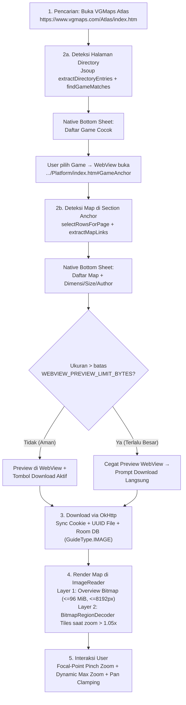

# Analisis Statis PixelGuide v1.5 — Arsitektur Fitur Map End-to-End (VGMaps & Dual-Layer Image Reader)

> **Tanggal analisis:** 2026-11-24  
> **Target APK:** `app.nanostack.pixelguide` v1.5 (`versionCode 19`, `minSdk 26`, `targetSdk 36`)  
> **SHA-256 APK:** `07a5e4ef2a8a94a14933ef78626c7e344aa28a47e83c8fe116129aa0a552b7ff`  
> **Lokasi file lokal saat analisis:** `/Users/ryan.setiawan/.gemini/antigravity-cli/brain/50c8f3d8-4bcc-40ef-9125-2b7fc68041f8/scratch/pixelguide-v1.5.apk`  
> **Mesin dekompilasi:** REA `6.7.0` + `jadx-headless-mcp-0.7.1-all.jar` (`rea-jadx-bridge` v4, Java `21.0.8`)  
> **Sifat analisis:** Read-only statis (tanpa eksekusi APK, tanpa panggilan API live).  
> **Cakupan:** Alur end-to-end Map (**pencarian data → pendeteksian → download & penyimpanan → rendering → interaksi user**). Fitur anotasi/penandaan di atas map **eksplisit tidak dibahas** sesuai permintaan tuan muda.  
> **Dokumen terkait:** [Analisis AI & ML PixelGuide v1.5](./pixelguide-v1.5-ai-analysis.md) · [Plan Adaptasi VGMaps Viewer untuk GameGuideGo](./plan/vgmaps-map-viewer.md)

---

## 1. Ringkasan Eksekutif

Keunggulan UX map di **PixelGuide v1.5** bukan berasal dari satu widget ajaib, melainkan dari **kombinasi 3 keputusan rekayasa yang saling melengkapi** *(Observasi Statis)*:

1. **WebView + Jsoup Hybrid + Native Bottom Sheet (`VGMapsParser` + `FindGuideScreenKt`):**
   - Situs retro seperti **VGMaps** masih berbentuk halaman HTML tabel statis tanpa API pencarian modern. PixelGuide tetap memakai WebView untuk mengambil HTML-nya, tetapi langsung **memanen DOM halaman via Jsoup** dan memunculkan **Native Bottom Sheet** (`VGMapsBrowseSheet`) berisi daftar game yang cocok dan daftar map per game lengkap dengan **dimensi piksel, ukuran file, format, dan nama pembuat map**. User tidak perlu melakukan *Ctrl+F* manual di HTML jadul.
2. **Guard Anti-Crash WebView (`isTooLargeForWebViewPreview` + `interceptLargeVGMapsImage`):**
   - Map retro (terutama *overworld* / *full dungeon atlas*) sering berukuran sangat besar dan dapat membekukan atau me-crash WebView saat dibuka langsung sebagai preview gambar. PixelGuide mencegat URL gambar yang ukuran file-nya melebihi ambang `WEBVIEW_PREVIEW_LIMIT_BYTES` sebelum dimuat ke WebView, lalu mengarahkan user untuk langsung men-download file gambar via `OkHttpClient`.
3. **Dual-Layer Tiled Rendering Engine (`ImageRenderEngine` + `ImageReaderKt`):**
   - Saat user membuka map berukuran ribuan hingga puluhan ribu piksel di reader, PixelGuide **tidak pernah men-decode piksel penuh ke RAM secara utuh**.
   - **Layer 1 (Base Overview Bitmap):** Menggambar gambaran utuh yang dibatasi ketat maksimal **96 MiB** memori bitmap dan **8192 px** per sisi, dengan auto-fallback ke `RGB_565` jika resolusinya bisa naik > 1.15× lebih tajam.
   - **Layer 2 (On-Demand HD Tile Overlay):** Begitu user memperbesar map melewati resolusi bitmap dasar (`totalContentScale > renderScale * 1.05f`), **`android.graphics.BitmapRegionDecoder`** hanya men-decode potongan tile di sekitar viewport yang sedang dilihat (`±1` tile prefetch margin) dengan `inSampleSize` yang menajam ke `1` (native 1:1) saat zoom semakin dalam.



---

## 2. Indeks Evidence REA/JADX

> **Batasan statis (berlaku untuk seluruh Evidence di bawah):** Analisis statis JADX tidak menjalankan aplikasi; perilaku runtime, nilai dinamis, pemanggilan reflektif, atau respons jaringan eksternal tidak dieksekusi.

| Operasi REA | Target | Cakupan / Catatan | Evidence ID |
|---|---|---|---|
| `inspect_android_package` | `pixelguide-v1.5.apk` | Manifest, permissions, 23.482 kelas, 734 resource | `ev_e0e1b4198b59d3802a02b7fec102270a2696e6a9a1a39ba6e71ae2138c4b5b33` |
| `search_android_classes` | `"app.nanostack.pixelguide"` & `"ImageReaderKt"` | 824 kelas app & seluruh inner class `ImageReaderKt` | `ev_d2d7ceecceaa756988db589a95946ed068478f35bd881e632f26f6412788f5a9`, `ev_da82198112a0688e4c452b5e48126e046335adcefc576e0c36894079402f935e` |
| `inspect_android_class` | `VGMapsParser` | Inventori field & 25 method parser VGMaps | `ev_57d9d86e887740bb9590f4dd8acb50c801d39b3847be12e8a3cedf25cffc0f63` |
| `inspect_android_class` | `FindGuideViewModel` | State flows, konstanta retry/gate, method provider | `ev_185037f76ba1c3f48ffc56c3bf1ce9b8e1167a9e26fc4059ed784829e85605f2` |
| `inspect_android_class` | `GuideProvider` | Enum provider (`VGMAPS`, `GAMEFAQS`, dll.) | `ev_6ca6383333de556689a6740a4780cb541252a891b1029747824b917e607e5ca8` |
| `inspect_android_class` | `VGMapsBrowseState`, `VGMapsGameEntry`, `VGMapsMapLink` | Model data hasil scan & pilihan map VGMaps | `ev_71f59378bff3c2a02b866b1e4d4f56d2ffe280ba89c333178b358599a9d393ed`, `ev_ce65e6a8c866dc66f575018b9ae79b3da57290f3ca17914055762ecca3498dd6`, `ev_de37cddd5d6c189019904fb0fac6b3608d9bd737296b1d14afad995a62443006` |
| `inspect_android_class` | `FindGuidePageKind`, `FindGuidePageState`, `DownloadRequestGate` | State halaman & lock single-flight download | `ev_6f83e0811c15e3bc1f1618cf210abf85728310fbb450d6c16f9cf661f5c3fd21`, `ev_ca9658a3ae228b2e2ac71d95af0f69a52e5e3741a24d8eebd1822ac0cb355d0b`, `ev_e0f09a8dc0285c3bef5b1334e3a82ad51cda3772b9f5378edce7ca7734c23165` |
| `inspect_android_class` | `FindGuideScreenKt`, `GuideStorageRepository` | Komponen UI bottom sheet & repositori penyimpanan file | `ev_78dfd2611a4ab17f8830afd5cfc8a484f4c45c99409e3c3008c63f483f6830fb`, `ev_7f289957d89b241806ac89337d261bafc27bc03d73f01d27f6c16345f6c57d6e` |
| `inspect_android_class` | `ImageRenderEngine`, `ImageRenderProfile`, `ImageRegionTile` | Arsitektur engine rendering base + tile + profile | `ev_7f76bd779c7b801cc019d92e2441f01be973f0a5f64c77e595060b9ee2b06644`, `ev_f61fdc95ce6a8e0da84f84c61e5560b2d7df271cbacd8ef0af9c30131e7fc2d8`, `ev_73e197f3d2a149eeccaa357e7e42645340ebbf789d3f7f18a1d64f15185c48c5` |
| `inspect_android_class` | `ImageReaderKt`, `ImageZoomPolicyKt`, `ZoomPanBoundsKt` | Composable reader gambar, policy zoom max & batas pan | `ev_f551b6129d6255868ed7b9ba4d41ac4931a95bac812fcc074ff3e3db1b97ef53`, `ev_9198351c45f973de9953c2885dc0478776f137c79ec120b5e9ed57c93d7de4b4`, `ev_5da8879fb3cee71f7e47d2820e79810521137d6a87bf5a4b5b081d8f6ee35dfa` |
| `inspect_android_method` | `GuideProvider.buildSearchUrl` | URL entry VGMaps Atlas | `ev_2cb98872a164e2628e40a1942be1f464b598ab1774400f751ec908b0b50796ef` |
| `inspect_android_method` | `VGMapsParser` (`<clinit>`, `extractDirectoryEntries`, `findGameMatches`, `selectRowsForPage`, `extractMapLinks`, `fileSizeBytes`, `isTooLargeForWebViewPreview`) | Regex pola parsing, stop-words, scoring fuzzy match, isolasi baris anchor `#fragment`, guard ukuran preview | `ev_5b719a1f32b543f73c2edc868695b4d73705d2b3185f31023259d4a4801f8938`, `ev_347358c5bb7387b1f69be8c4c7a3aa3bebe67cbe695a1f9d1390fa19c9cc0163`, `ev_b2a063b38b03c32b6dcf7e4cba8a5437a331d167b4f759ff77fabb5721a47559`, `ev_36405d23f48d7a85e07ccffa5ce5c5ba8d65c53c37bfc9aaaf0c6e33f111d0fe`, `ev_f64b61a4370171e00f9fe7cde04384dc12e673d824a10ab3416a275596b089f5`, `ev_841ad837b92a6eba0e0988b7d4b87c290b20c52bc935c71eadf9c69634c7e4b6`, `ev_9e9eecfe1f3bced0fc893bf0d0249d252fb1bd6274a3e59983b2eda1a472704c` |
| `inspect_android_method` | `FindGuideViewModel` (`analyzeVGMapsPage`, `$analyzeVGMapsPage$browseState$1.invokeSuspend`, `selectVGMapsMap`, `downloadGuide`, `downloadVGMapsGuide`, `downloadImage`, `saveGameAndGuide`, `analyzeGameFaqsPage`, `downloadGameFaqsMapGuide`) | Alur analisis halaman WebView, download OkHttp + cookie sync, simpan ke Room `GuideType.IMAGE`, jalur map GameFAQs `?raw=1` | `ev_afdf1cd0ba579db514d0518714fb3f71c3a2e7fa044753ec58961b65d319435c`, `ev_122a4571f105ba096584aebd7fe1224e3b2c63226b57e376c23029633a64335c`, `ev_85ac54c746f6ee475313a67c978144224800414b1114eae735afcf024697e759`, `ev_a426d31c7c1235d2137faf7d61c325bd9e3c7b11e84e0304a7ce8f9fad56e256`, `ev_94edb06f0ea081fce21b6f6a0e13598b127e4189bb6b80739cd04ab27487c01a`, `ev_97fb44b50f72bb90a30851df180d5d26091525b70d6cd1db6d4b8c7a75a0d27f`, `ev_715c70f581c9736e180d2ce2ddf878e1ea20a782e0a215a4c8381580de3949d1`, `ev_bef56de1a8050069469f00e286bac1f19c238d8baa154e6579ef177419413227`, `ev_9191d4e194c47b24423c42eb959e25dae99c6d02fdf5e053a9a6a8e15dd74f9f` |
| `inspect_android_method` | `FindGuideScreenKt` (`FindGuideScreen$interceptLargeVGMapsImage`, `FindGuideScreen$requestVGMapsMapPreview`, `VGMapsBrowseSheet`) | Guard pencegahan preview map besar & tampilan Bottom Sheet native | `ev_c7ab5227ce2366168e47778926aae71bc71f7c1594f80d129374b2fdb566eebf`, `ev_65244486398fb73a78ef383aa92a21bd7c497f40db124b0deef8f796ab7c6e03`, `ev_67523f713ee56b67e7b3b5f36b4369313397af9664b4585201a21aabe8ccb279` |
| `inspect_android_method` | `ImageRenderEngine` & `ReaderViewModel` (`<clinit>`, `open`, `$open$2$1`, `getRenderProfile`, `clampRenderScale`, `computeSampleSize`, `decodeImageBitmap`, `renderTiles`, `$renderTiles$2$1`, `computeTileSampleSize`, `computeTileSourceSize`, `decodeRegionBitmap`, `ReaderViewModel.renderImageTiles`) | Decoding `BitmapRegionDecoder`, batas 96 MiB / 8192 px, auto `RGB_565`, grid tile + margin `±1`, fallback OOM | `ev_e91402f2ac732cbdb8f60e0d7a9ae04d53091a8daf13cbf882877b5ff44fbd7b`, `ev_bd0fa3c09fe7d530e09d32204d8c82fd7dc8faad8b81db19b9dcf927c16337e9`, `ev_f03f092583046a1c649ac310de89ae13e14324ad3d02fbd221b39c0d2044e9fb`, `ev_bedc2a02e15a16f8072afb60cd0df0e2f8414a085d42e03a49393ac95c85d471`, `ev_59ce10cb33b862db6a966305dc50dac099481cdf204db1fe3c3f8fbffb70c850`, `ev_091420de273d4b9f4098520264402e3b03c64d25f947c7bd1d81b179850ef619`, `ev_deeefe5bb2c5815bcd2baad8d92a32bcaeff0f2466f5f13094b89328e53ed68a`, `ev_a32e8f486134268b7d7617272a6f8d65c940576a97142a2accb73436969227ad`, `ev_82cb8fca0ae6c4774b8d0aa1d86d90f5b73333487d57139913c28702fdd30c99`, `ev_f9ad773f124ff4d41550a1bc80036b5c59cfbda580c21db7cfc796f8bd3329e9`, `ev_54161aefecb12b3f01ab522315557cd43397520f56a0fa2968f2a9ab64743717`, `ev_c33afdff13f78dc4af08f9324a5ab64bd3f9cd2f086ab1f4382e6a0de8ebca99`, `ev_878f89dcf07cfe6ccdf8a8478303937964a09ffb72ed630b598ae68e2f9a2992` |
| `inspect_android_method` | `ImageReaderKt`, `ImageZoomPolicyKt`, `ZoomPanBoundsKt` | Composable efek, trigger tile `1.05f`, zoom max adaptif, rumus pinch focal-point & pan clamping | `ev_74b1a015904489dbc19fe0fce4509e8dd6f2b4cc089c37ba0929f3dbc086f2e2`, `ev_d89f47cf86cf213518afb43eeb1b79034746dd8b84e9c2a17d0a6698def905fb`, `ev_b0265b6b859d07288b351ac622af269039927b783c6a1dfcc63b26eea1306166`, `ev_e7f764ed35b9e277b295b0d7e1714f2aaeb94578810ad130d9d25907347727b1`, `ev_08995fa1b7a088378d2384858aaa8fb1f6691ac27ff330c7f9856e78816490fd`, `ev_36646e49edf1c93928bf7bdbb15772625bb49092973e16b0d9180ff396d546fd`, `ev_5051cec8adefa29927ce60f43714e6de3ecd554c5ebd92bf9dc01d91ef05ae22`, `ev_9e032fabff59cea0bcbefa4693232aee83e3974fe648af4fde3a92644d4c9599`, `ev_63c7ddbf38e6a13d156ee8436eda5f886e7bfc18f8e8f997ffd3383c46914352`, `ev_0ddc4038879fd15d4aad8ac4975dacfcb6c51fad1c255657b281430eb3bf3499` |

---

## 3. Tahap 1 — Pencarian Data & Fuzzy Matching (`GuideProvider.VGMAPS`, `VGMapsParser`, `VGMapsBrowseSheet`)

### 3.1 Titik Masuk Pencarian *(Observasi Statis)*

- `GuideProvider.buildSearchUrl(gameName)` (`ev_2cb98872a164e2628e40a1942be1f464b598ab1774400f751ec908b0b50796ef`) memetakan `GuideProvider.VGMAPS` **langsung ke halaman direktori master VGMaps**, bukan ke search query URL:
  ```text
  https://www.vgmaps.com/Atlas/index.htm
  ```
- Sementara itu, nama game yang dicari user disimpan pada field `FindGuideViewModel.pendingVGMapsGameName` (`ev_185037f76ba1c3f48ffc56c3bf1ce9b8e1167a9e26fc4059ed784829e85605f2`).

### 3.2 Ekstraksi Direktori Game (`VGMapsParser.extractDirectoryEntries`) *(Observasi Statis)*

Saat halaman Atlas selesai dimuat di WebView, `FindGuideViewModel.analyzeVGMapsPage` (`ev_afdf1cd0ba579db514d0518714fb3f71c3a2e7fa044753ec58961b65d319435c`) mengambil HTML halaman lewat `extractCurrentPageHtml(webView)` dan memanggil `FindGuideViewModel$analyzeVGMapsPage$browseState$1` di `Dispatchers.Default` (`ev_122a4571f105ba096584aebd7fe1224e3b2c63226b57e376c23029633a64335c`).

Jika `VGMapsParser.isAtlasDirectoryUrl(currentUrl)` bernilai `true`, parser menjalankan `extractDirectoryEntries(document, currentUrl)` (`ev_347358c5bb7387b1f69be8c4c7a3aa3bebe67cbe695a1f9d1390fa19c9cc0163`) memakai **Jsoup**:
1. Memilih semua tag `<a href>` dengan teks tautan yang sudah dibersihkan (`cleanText`).
2. Me-resolve URL relatif terhadap `baseUrl` menjadi `URI`.
3. Menerapkan 4 syarat penyaringan ketat:
   - Host berada di domain VGMaps (`isVGMapsHost(uri.host)`).
   - URI memiliki **fragment** (`uri.rawFragment != null && !isBlank`).
   - Path URI (lowercase) berakhiran `/index.htm`.
   - Nama platform berhasil diekstrak dari segmen path (`extractPlatform(path)`).
4. Menghasilkan `VGMapsGameEntry(title, platform, url)` (`ev_ce65e6a8c866dc66f575018b9ae79b3da57290f3ca17914055762ecca3498dd6`) dan menduplikasi entri berdasarkan URL dengan pembanding kualitas `isBetterDuplicateEntry`.

### 3.3 Algoritma Pencocokan & Skor Game (`VGMapsParser.findGameMatches`) *(Observasi Statis)*

`VGMapsParser.<clinit>` (`ev_5b719a1f32b543f73c2edc868695b4d73705d2b3185f31023259d4a4801f8938`) dan `findGameMatches` (`ev_b2a063b38b03c32b6dcf7e4cba8a5437a331d167b4f759ff77fabb5721a47559`) melakukan normalisasi serta pemeringkatan skor bertingkat terhadap `pendingVGMapsGameName`:

- **Pembersihan & Tokenisasi:**
  - `trailingParentheticalPattern`: `\s+\([^)]{1,40}\)\s*$` (memangkas info tambahan dalam kurung di akhir judul).
  - `SEARCH_STOP_WORDS`: `{"of", "the", "and", "a", "an"}`.
  - `SEARCH_METADATA_TOKENS`: `{"usa", "us", "u", "europe", "eur", "e", "japan", "jp", "j", "world", "rev", "revision"}`.
- **Fase 1 (Exact Match Fast-Path):**
  - Jika ada entri yang `normalizeSearchText(entry.title) == normalizeSearchText(query)` atau `canonicalSearchText(entry.title) == canonicalSearchText(query)`, entri tersebut langsung diurutkan alfabetis dan dikembalikan (dibatasi `limit`).
- **Fase 2 (Scoring Bertingkat jika Fase 1 kosong):**
  Setiap entri diberi skor berikut (dengan `k = jumlah token query yang cocok` dan `ratio = k / queryTokens.size`):

| Kondisi Kecocokan | Skor |
|---|---|
| `normalized(entry) == normalized(query)` | `1000` |
| `canonical(entry) == canonical(query)` | `950` |
| `normalized(entry).contains(normalized(query))` | `800 + k` |
| `canonical(entry).contains(canonical(query))` | `750 + k` |
| Semua token query ada pada token entri | `500 + k` *(Catatan dekompilasi: JADX mencetak konstanta `500` sebagai `AskPixieViewModel.MAX_QUESTION_LENGTH` karena sharing konstanta integer yang sama)* |
| `k >= 2` dan `ratio >= 0.9` | `floor(ratio * 100) + k` |
| Selain di atas | `0` (dibuang) |

- Hasil diurutkan berdasarkan skor tertinggi, lalu judul alfabetis (`thenBy`), dan diambil sebanyak `limit`.
- UI menampilkan hasil ke dalam `VGMapsBrowseSheet` → `VGMapsGameMatchList` (`ev_67523f713ee56b67e7b3b5f36b4369313397af9664b4585201a21aabe8ccb279`) sehingga user cukup mengetuk nama game untuk melompat ke halaman map game tersebut (`.../Platform/index.htm#GameAnchor`).

---

## 4. Tahap 2 — Pendeteksian Halaman Map & Guard Anti-Crash WebView

### 4.1 Klasifikasi Halaman (`analyzeVGMapsPage`) *(Observasi Statis)*

`FindGuideViewModel.analyzeVGMapsPage` (`ev_afdf1cd0ba579db514d0518714fb3f71c3a2e7fa044753ec58961b65d319435c`) membagi halaman VGMaps menjadi 3 status (`FindGuidePageKind`: `ev_6f83e0811c15e3bc1f1618cf210abf85728310fbb450d6c16f9cf661f5c3fd21`):

1. **Direct Image URL (`VGMapsParser.isImageUrl`):**
   - Ekstensi yang dikenali (`imageFileExtensions`, `ev_5b719a1f32b543f73c2edc868695b4d73705d2b3185f31023259d4a4801f8938`): `png`, `gif`, `jpg`, `jpeg`, `webp`, `bmp`.
   - Langsung menetapkan `FindGuidePageState(FindGuidePageKind.MAP, canDownload = true)` (`ev_ca9658a3ae228b2e2ac71d95af0f69a52e5e3741a24d8eebd1822ac0cb355d0b`) dan mengisi `selectedMap` (atau membuat metadata baru via `mapLinkFromImageUrl`).
2. **Halaman Direktori Atlas:**
   - Memunculkan daftar `gameMatches`.
3. **Halaman Daftar Map Game (`.../Platform/index.htm#GameAnchor`):**
   - Mengekstrak daftar map hanya dari blok game terkait dan menampilkannya pada `VGMapsMapLinkList` di bottom sheet.

### 4.2 Isolasi Blok Anchor & Parsing Metadata Map *(Observasi Statis)*

- **Anchor-to-Anchor Slicing (`VGMapsParser.selectRowsForPage`, `ev_36405d23f48d7a85e07ccffa5ce5c5ba8d65c53c37bfc9aaaf0c6e33f111d0fe`):**
  - Satu halaman HTML platform di VGMaps berisi daftar map untuk banyak game dalam satu `<table>` besar.
  - Parser mengambil `rawFragment` dari `pageUrl`, mencari elemen anchor via `findAnchor(document, fragment)` (`<a name="...">` atau `[id="..."]`), lalu naik ke baris `<tr>` terdekat (`closest("tr")`) dan induk `<table>`-nya.
  - Selanjutnya, parser mengambil baris-baris `<tr>` **setelah** baris anchor tersebut dan **berhenti seketika saat menemukan `<a name>` atau `[id]` milik game berikutnya**. *(Catatan unik dekompilasi: JADX me-render string konstanta `"tr"` sebagai `TranslateLanguage.TURKISH` karena nilai literalnya identik.)*
- **Ekstraksi Metadata per Map (`VGMapsParser.extractMapLinks`, `ev_f64b61a4370171e00f9fe7cde04384dc12e673d824a10ab3416a275596b089f5`):**
  - Untuk setiap `<tr>` yang memiliki `<a href>` bertipe URL gambar, parser mengekstrak seluruh sel kolomnya dan mencocokkan regex dari `<clinit>` (`ev_5b719a1f32b543f73c2edc868695b4d73705d2b3185f31023259d4a4801f8938`):
    - **Dimensi (`dimensionsPattern`):** `\b\d{2,}\s*x\s*\d{2,}\b` (contoh: `4096 x 3072`).
    - **Ukuran File (`fileSizePattern`):** `\b\d+(?:\.\d+)?\s*(?:kb|kib|mb|mib|bytes?)\b`.
    - **Format (`formatTokens`):** `PNG`, `GIF`, `JPG`, `JPEG`, `WEBP`, `BMP` (fallback ke ekstensi URL jika kolom format tidak ada).
    - **Pembuat Map:** `extractAuthor()`.
  - Hasilnya dibentuk menjadi `VGMapsMapLink(mapName, imageUrl, dimensions, fileSize, format, author, guideTitle)` (`ev_de37cddd5d6c189019904fb0fac6b3608d9bd737296b1d14afad995a62443006`).
- **Konversi Ukuran File (`VGMapsParser.fileSizeBytes`, `ev_841ad837b92a6eba0e0988b7d4b87c290b20c52bc935c71eadf9c69634c7e4b6`):**
  - `bytes`/`byte` → `× 1.0`
  - `kb`/`kib` → `× 1024.0`
  - `mb`/`mib` → `× 1048576.0` (`1024 × 1024`)

### 4.3 Guard Anti-Crash Preview WebView *(Observasi Statis)*

- `VGMapsParser.isTooLargeForWebViewPreview(mapLink)` (`ev_9e9eecfe1f3bced0fc893bf0d0249d252fb1bd6274a3e59983b2eda1a472704c`) membandingkan `fileSizeBytes(mapLink.fileSize) > WEBVIEW_PREVIEW_LIMIT_BYTES`.
- Dipakai di dua tempat UI di `FindGuideScreenKt`:
  1. **`FindGuideScreen$requestVGMapsMapPreview`** (`ev_65244486398fb73a78ef383aa92a21bd7c497f40db124b0deef8f796ab7c6e03`): Saat user mengetuk item map di bottom sheet — jika `isTooLargeForWebViewPreview` bernilai `true`, URL gambar **tidak dimuat ke WebView**, melainkan disimpan ke state dialog/prompt untuk langsung di-download. Jika aman, barulah `selectVGMapsMap` dan `loadProviderUrl` dipanggil.
  2. **`FindGuideScreen$interceptLargeVGMapsImage`** (`ev_c7ab5227ce2366168e47778926aae71bc71f7c1594f80d129374b2fdb566eebf`): Mencegat klik link gambar besar langsung di dalam WebView dengan mengecek kecocokan URL terhadap `vgMapsBrowseState.mapLinks`.

### 4.4 Jalur Map Tambahan: GameFAQs (`analyzeGameFaqsPage`) *(Observasi Statis)*

- Di luar VGMaps, `FindGuideViewModel.analyzeGameFaqsPage` (`ev_bef56de1a8050069469f00e286bac1f19c238d8baa154e6579ef177419413227`) juga mendeteksi halaman map di GameFAQs dengan menjalankan JS di WebView:
  ```javascript
  document.querySelector('a[href*="?raw=1"]') !== null
  ```
  Jika elemen tersebut ditemukan, halaman langsung ditandai sebagai `FindGuidePageKind.MAP` dengan `canDownload = true`.

---

## 5. Tahap 3 — Download & Penyimpanan Lokal

### 5.1 Gate Single-Flight & Alur `downloadVGMapsGuide` *(Observasi Statis)*

- `FindGuideViewModel.downloadGuide` (`ev_a426d31c7c1235d2137faf7d61c325bd9e3c7b11e84e0304a7ce8f9fad56e256`) memanggil `DownloadRequestGate.tryStart()` (`AtomicBoolean`, `ev_e0f09a8dc0285c3bef5b1334e3a82ad51cda3772b9f5378edce7ca7734c23165`) sebelum meluncurkan coroutine download agar permintaan ganda diabaikan.
- Di dalam `downloadVGMapsGuide` (`ev_94edb06f0ea081fce21b6f6a0e13598b127e4189bb6b80739cd04ab27487c01a`):
  1. **Target Map:** Mengambil `selectedMap` dari `_vgMapsBrowseState`; jika sedang membuka URL gambar langsung di WebView tanpa sheet, fallback membangun `VGMapsMapLink` via `mapLinkFromImageUrl`.
  2. **Sinkronisasi Cookie (`syncCookiesFromWebView`):** Menyalin cookie WebView ke `CookieJar` milik `OkHttpClient` untuk URL halaman maupun URL gambar sebelum melakukan request biner (mengurangi risiko HTTP 403/blokir hotlink).
  3. **Penamaan File Aman:** Membuat file lokal di direktori aplikasi (`filesDir`) menggunakan `UUID.randomUUID()` dan ekstensi gambar yang dibersihkan `SAFE_FILENAME_REGEX`.
  4. **Download Biner:** Memanggil `downloadImage()` (`ev_97fb44b50f72bb90a30851df180d5d26091525b70d6cd1db6d4b8c7a75a0d27f`) pada `Dispatchers.IO` sembari memancarkan progres melalui `_downloadStatus` (`DownloadStatus.Downloading`).
  5. **Persistensi Database (`saveGameAndGuide`, `ev_715c70f581c9736e180d2ce2ddf878e1ea20a782e0a215a4c8381580de3949d1`):** Menyimpan `GuideEntity` ke Room DB (`GameDao.insertGuide`) dengan **`GuideType.IMAGE`**, judul dari `VGMapsMapLink.guideTitle`, dan path lokal absolut file gambar, lalu mengirim event `FindGuideUiEvent.GuideDownloaded`.
  6. **Penanganan Error & Cancel:** Mengecek kode error `403`/`429` pada pesan error untuk menampilkan pesan ramah pengguna, serta memanggil `cleanupPartialDownload()` ketika job dibatalkan (`CancellationException`).
- **Jalur GameFAQs Map (`downloadGameFaqsMapGuide`, `ev_9191d4e194c47b24423c42eb959e25dae99c6d02fdf5e053a9a6a8e15dd74f9f`):** Mengevaluasi JS `(function() { var a = document.querySelector('a[href*="?raw=1"]'); return a ? a.href : ''; })();`, sync cookie, mengunduh gambar ke `map_<UUID>.jpg`, dan menyimpannya sebagai `GuideType.IMAGE`.

---

## 6. Tahap 4 — Rendering & Tampilan Map (`ImageRenderEngine` + `ImageReaderKt`)

Seluruh pipeline decoding dijalankan oleh `ImageRenderEngine` (`ev_7f76bd779c7b801cc019d92e2441f01be973f0a5f64c77e595060b9ee2b06644`), dijembatani oleh `ReaderViewModel.renderImageTiles` (`ev_878f89dcf07cfe6ccdf8a8478303937964a09ffb72ed630b598ae68e2f9a2992`), dan digambar ke layar Jetpack Compose oleh `ImageReaderKt` (`ev_74b1a015904489dbc19fe0fce4509e8dd6f2b4cc089c37ba0929f3dbc086f2e2`).

### 6.1 Inisialisasi File & `BitmapRegionDecoder` *(Observasi Statis)*

- `ImageRenderEngine.open(file)` (`ev_bd0fa3c09fe7d530e09d32204d8c82fd7dc8faad8b81db19b9dcf927c16337e9`) & `$open$2$1` (`ev_f03f092583046a1c649ac310de89ae13e14324ad3d02fbd221b39c0d2044e9fb`):
  - Menggunakan coroutine `Mutex` (`imageMutex`) di `Dispatchers.IO`.
  - Membaca dimensi gambar tanpa mengalokasikan piksel via `BitmapFactory.Options.inJustDecodeBounds = true` → menghasilkan `ImageSourceInfo(width, height)`.
  - Membuka `BitmapRegionDecoder.newInstance(absolutePath, false)` dan menyimpannya ke `this.regionDecoder` (jika format gambar tidak mendukung region decoding, `regionDecoder` diset `null` dengan graceful fallback ke layer overview saja).

### 6.2 Layer 1 — Base Overview Bitmap & Proteksi OOM *(Observasi Statis)*

- Saat file dibuka, efek Compose `ImageReader$8$1` (`ev_d89f47cf86cf213518afb43eeb1b79034746dd8b84e9c2a17d0a6698def905fb`) me-reset state (`renderScale = 0.05f`), lalu `ImageReader$9$1` (`ev_b0265b6b859d07288b351ac622af269039927b783c6a1dfcc63b26eea1306166`) memanggil `viewModel.getMaxWholeImageRenderProfile()`.
- **`clampRenderScale` (`ev_59ce10cb33b862db6a966305dc50dac099481cdf204db1fe3c3f8fbffb70c850`) & `computeSampleSize` (`ev_091420de273d4b9f4098520264402e3b03c64d25f947c7bd1d81b179850ef619`)** memaksakan dua batas keras untuk bitmap dasar:
  1. **Batas ukuran byte bitmap:** `1.00663296E8` bytes = **96 MiB** (`96 × 1024 × 1024` — aman di bawah limit `RecordingCanvas` Android 100 MB).
  2. **Batas dimensi maksimum:** **8192 × 8192 px** (`8192.0d`).
- **Auto-Select `ARGB_8888` vs `RGB_565` (`getRenderProfile`, `ev_bedc2a02e15a16f8072afb60cd0df0e2f8414a085d42e03a49393ac95c85d471`):**
  - Menghitung skala aman maksimum untuk `ARGB_8888` (4 byte/piksel) dan `RGB_565` (2 byte/piksel).
  - Jika `RGB_565` memungkinkan skala **> `1.15f` kali lebih tinggi** dengan selisih minimal `MIN_RENDER_SCALE`, engine memilih `ImageRenderProfile(scale565, preferRgb565 = true)` (`ev_f61fdc95ce6a8e0da84f84c61e5560b2d7df271cbacd8ef0af9c30131e7fc2d8`).
- **OOM Retry Multi-Tahap (`decodeImageBitmap`, `ev_deeefe5bb2c5815bcd2baad8d92a32bcaeff0f2466f5f13094b89328e53ed68a` & `ImageReader$10$1`, `ev_e7f764ed35b9e277b295b0d7e1714f2aaeb94578810ad130d9d25907347727b1`):**
  - Jika `BitmapFactory.decodeFile` melempar `OutOfMemoryError`, `decodeImageBitmap` menggandakan `extraSampleMultiplier *= 2` hingga `< 16`, lalu fallback ke `RGB_565`.
  - Jika masih gagal di sisi UI, `ImageReader$10$1` menurunkan `renderScale *= 0.5f` (minimal `0.05f`) untuk memicu re-decode ulang di skala lebih ringan.
- Hasil overview bitmap disimpan ke LRU cache `renderCache`.

### 6.3 Layer 2 — On-Demand HD Tile Overlay (`BitmapRegionDecoder`) *(Observasi Statis)*

- **Syarat Aktivasi (`ImageReader$11$1`, `ev_08995fa1b7a088378d2384858aaa8fb1f6691ac27ff330c7f9856e78816490fd`):**
  - Tile overlay hanya di-render jika `viewModel.canRenderImageTiles()` bernilai `true` **DAN**:
    ```kotlin
    totalContentScale > renderScale * 1.05f
    ```
  - Ketika user men-zoom keluar di bawah ambang tersebut, `$visibleTiles$delegate` dikosongkan (`emptyList()`) untuk membebaskan memori.
- **Pemetaan Viewport → Koordinat Asli Gambar:**
  - `ImageReader$11$1` memotong area viewport yang beririsan dengan gambar yang tergambar, lalu memproyeksikannya ke `android.graphics.Rect` dalam ruang piksel asli sumber gambar:
    `left = ((fMax - imageLeft) / totalContentScale)`, dst.
- **Algoritma Grid & Prefetch (`ImageRenderEngine$renderTiles$2$1`, `ev_82cb8fca0ae6c4774b8d0aa1d86d90f5b73333487d57139913c28702fdd30c99`):**
  - `computeTileSampleSize(targetPixelsPerSourcePixel)` (`ev_f9ad773f124ff4d41550a1bc80036b5c59cfbda580c21db7cfc796f8bd3329e9`):
    ```kotlin
    max(floor(1.0f / targetPixelsPerSourcePixel).toInt(), 1)
    ```
  - `computeTileSourceSize(sampleSize)` (`ev_54161aefecb12b3f01ab522315557cd43397520f56a0fa2968f2a9ab64743717`):
    ```kotlin
    coerceIn(sampleSize * 1024, 512, 4096)
    ```
    Ini membuat ukuran potongan sumber otomatis membesar ketika di-zoom out dan mengecil hingga `512`–`1024 px` ketika di-zoom in agar dimensi bitmap hasil decode tetap stabil ~1024 px.
  - **Margin Prefetch `±1` Tile:** Rentang kolom dan baris dihitung dari `(left / tileSize) - 1` hingga `(right / tileSize) + 1` (demikian pula `top` dan `bottom`), sehingga geseran kecil sudah memiliki tile siap pakai di cache.
  - **Cooperative Cancellation:** Setiap iterasi memanggil `JobKt.ensureActive(context)` agar decode tile lama langsung dibatalkan saat user menggulir cepat.
  - **Cache & OOM Guard per Tile (`decodeRegionBitmap`, `ev_c33afdff13f78dc4af08f9324a5ab64bd3f9cd2f086ab1f4382e6a0de8ebca99`):** Disimpan di `tileCache` dengan key `(tileRect, sampleSize, useRgb565)`; jika terjadi `OutOfMemoryError`, `extraSampleMultiplier` digandakan hingga `< 8` lalu fallback ke `RGB_565`.

---

## 7. Tahap 5 — Interaksi User (`ImageZoomPolicyKt`, `ZoomPanBoundsKt`, `ImageReaderKt`)

### 7.1 Batas Zoom Maksimum Adaptif (`ImageZoomPolicyKt.calculateImageMaxZoom`) *(Observasi Statis)*

(`ev_63c7ddbf38e6a13d156ee8436eda5f886e7bfc18f8e8f997ffd3383c46914352`):
```kotlin
if (width <= 0 || height <= 0 || viewportWidth <= 0f || viewportHeight <= 0f) return 4.0f
return ((1.0f / max(fitScale, 0.01f)) * 8.0f).coerceIn(4.0f, IMAGE_MAX_ALLOWED_ZOOM)
```
- Karena `fitScale` pada map ekstra lebar/besar bernilai sangat kecil (misalnya `0.1`), `1.0f / fitScale` mengembalikan skala hingga ukuran asli 1:1, lalu dikalikan **`8.0f`** (`IMAGE_NATIVE_ZOOM_MULTIPLIER`).
- Hasilnya: meski map berukuran ribuan piksel, user tetap dapat men-zoom melampaui 100% ukuran piksel aslinya (krusial untuk membaca sprite/teks kecil di map game retro) tanpa mentok di `4×` viewport.

### 7.2 Focal-Point Pinch Zoom & Drag Pan (`ImageReader$13$1$1`) *(Observasi Statis)*

(`ev_5051cec8adefa29927ce60f43714e6de3ecd554c5ebd92bf9dc01d91ef05ae22`, `ev_36646e49edf1c93928bf7bdbb15772625bb49092973e16b0d9180ff396d546fd`):
- Input sentuh ditangani oleh `TransformGestureDetectorKt.detectTransformGestures` di dalam `Modifier.pointerInput`.
- Rumus transformasi menghitung perpindahan offset relatif terhadap **`centroid` (titik tengah dua jari)**:
  ```kotlin
  val targetScale = (currentScale * zoomChange).coerceIn(1.0f, maxZoom)
  val scaleRatio = targetScale / currentScale
  val currentCenterX = viewportWidth / 2f + currentOffset.x
  val currentCenterY = viewportHeight / 2f + currentOffset.y
  val focalDx = centroid.x - currentCenterX
  val focalDy = centroid.y - currentCenterY
  val factor = 1f - scaleRatio
  val newX = (currentOffset.x + panChange.x + focalDx * factor).coerceIn(-maxPanX, maxPanX)
  val newY = (currentOffset.y + panChange.y + focalDy * factor).coerceIn(-maxPanY, maxPanY)
  ```
- Visual layer menerapkan transformasi via `Modifier.graphicsLayer` (akselerasi GPU di thread render Compose) agar gerakan jari 60fps tanpa menunggu re-decode tile `BitmapRegionDecoder`.

### 7.3 Batas Geser Ketat & Persistensi State *(Observasi Statis)*

- **`ZoomPanBoundsKt.calculatePagePanBounds` (`ev_0ddc4038879fd15d4aad8ac4975dacfcb6c51fad1c255657b281430eb3bf3499`):**
  ```kotlin
  val minScale = min(viewportWidth / contentWidth, viewportHeight / contentHeight)
  val maxPanX = max(0f, (contentWidth * minScale * scale - viewportWidth) / 2f)
  val maxPanY = max(0f, (contentHeight * minScale * scale - viewportHeight) / 2f)
  ```
- **Re-clamping saat Resize/Rotasi (`ImageReader$13$3$1`, `ev_9e032fabff59cea0bcbefa4693232aee83e3974fe648af4fde3a92644d4c9599`):** Saat dimensi layar atau `fitScale` berubah, offset otomatis di-clamp ulang ke `[-maxPanX, +maxPanX]` dan `[-maxPanY, +maxPanY]` agar gambar tidak keluar batas.
- **Persistensi Posisi:** Setiap gestur memanggil callback `onStateChanged(scale, offset)` ke `ReaderViewModel` untuk menyimpan posisi dan level zoom map.

---

## 8. Batasan & Pemisahan Observasi Statis vs Inferensi

| Kategori | Fakta / Interpretasi |
|---|---|
| **Observasi Statis (Terbukti di Bytecode/JADX)** | Seluruh struktur kelas, URL `https://www.vgmaps.com/Atlas/index.htm`, daftar stop-word dan metadata token, rumus skor `findGameMatches`, mekanisme isolasi tabel `selectRowsForPage`, regex dimensi & ukuran file, gate `DownloadRequestGate`, penyimpanan `GuideType.IMAGE`, batas overview bitmap `96 MiB` dan `8192 px`, threshold tile `1.05f`, ukuran tile `coerceIn(sampleSize * 1024, 512, 4096)` + margin `±1`, rumus `calculateImageMaxZoom`, serta rumus focal-point pinch zoom dan `calculatePagePanBounds`. |
| **Inferensi** | 1. Nilai numerik literal dari dua `const val` yang di-inline Kotlin (`WEBVIEW_PREVIEW_LIMIT_BYTES` dan `IMAGE_MAX_ALLOWED_ZOOM`) tidak ditampilkan sebagai angka mentah pada output Java dekompilasi di metode pemanggilnya, meski cara pemakaiannya terverifikasi penuh.<br/>2. Perilaku jaringan live server VGMaps (rate limit, perubahan layout HTML masa depan, atau header anti-hotlink) dan performa FPS nyata pada perangkat keras tertentu tidak diuji karena analisis bersifat statis. |

Untuk rancangan adaptasi pipeline ini ke stack **GameGuideGo** (Next.js + Supabase + PWA Offline-First tanpa anotasi di v1), lihat dokumen rencana eksekusi di [**docs/plan/vgmaps-map-viewer.md**](./plan/vgmaps-map-viewer.md).
