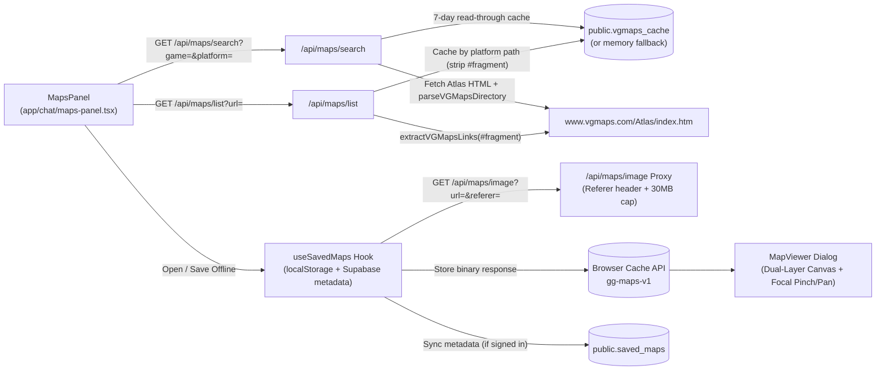

# Plan: Seamless VGMaps Search, Offline Saving & High-Res Map Viewer (v1 — No Annotations)

**Status:** Planned (ready for agent execution)  
**Target stack:** Next.js App Router (React 19) + pure JS modules (`lib/`) + browser Cache API / `localStorage` + optional Supabase sync (`public.vgmaps_cache`, `public.saved_maps`)  
**Architecture reference:** [`docs/pixelguide-v1.5-map-analysis.md`](../pixelguide-v1.5-map-analysis.md)  
**Zero new npm dependencies (Ponytail principle):** Pure HTML table parser (no `cheerio`/`jsdom` needed unless edge cases prove otherwise), pure `<canvas>` + Pointer Events viewer (no heavy mapping library), reusing GameGuideGo's existing split-pane, `<dialog>`, proxy, and offline-first sync architecture.

---

## 1. Product Goal, Scope & Non-Goals

### Goal
Give GameGuideGo players a seamless **VGMaps** workflow inside any game chat:
1. **Auto-search & fuzzy match** the active game (and console/platform) against the VGMaps Atlas directory — presented in a native UI drawer/side-column (never exposing legacy raw HTML tables or WebViews).
2. **Anchor-scoped map detection** that parses each game's map rows (map title, pixel dimensions, file size, format, author) and warns/protects before loading huge (>6 MiB) images into preview.
3. **Offline-first download & persistence** via same-origin streaming proxy → browser `Cache API` (`gg-maps-v1`) + `localStorage` (`gg:saved-maps`), working **with zero login wall** for anonymous players and syncing metadata cleanly to `public.saved_maps` for signed-in users (without storing heavy map binaries in Supabase Storage).
4. **Smooth high-res interactive viewer** using a PixelGuide-inspired dual-layer Canvas engine: fast downsampled overview canvas during active gestures + viewport-clipped HD `ImageBitmap` drawing when zoomed past overview scale, plus focal-point pinch/wheel zoom, strict pan bounds, **Pixel Crisp** (`imageSmoothingEnabled = false`) toggle for retro pixel-art maps, and per-map zoom/offset memory.

### Explicit Non-Goals (Deferred to v2)
- Map annotations, pins, drawing tools, or spoiler-tagged markers on maps.
- Scraping GameFAQs `?raw=1` map images (Cloudflare/Playwright complexity out of scope for v1).
- Sending high-res maps into Gemini Vision / RAG chunking.

### Mandatory Project Guardrails
- **UI/UX Contrast Rule (`.agents/AGENTS.md`):** Never place white text on bright/light background colors (`var(--signal)`, bright cyan, bright green) for chips, badges, or buttons. Always use `var(--on-signal)` or `var(--ink)`.
- **No Login Wall:** Signed-out users can search, view, and save maps offline in `localStorage` + `Cache API`. Signed-in sync to `public.saved_maps` must fail quietly if the migration hasn't been applied (`isMissingTableError` pattern from `use-saved-answers.tsx`).
- **Supabase Rule:** When executing database changes, use the **Supabase MCP** (`apply_migration`), not manual CLI commands.

---

## 2. Architecture Overview



---

## 3. Exact File Manifest

### A. Pure Logic & Cache Helpers (`lib/`)

1. **`lib/vgmaps-parser.js`** *(new, pure ESM, tested in `scripts/check.mjs`)*
   - Constants:
     - `VGMAPS_ATLAS_URL = "https://www.vgmaps.com/Atlas/index.htm"`
     - `LARGE_MAP_WARNING_BYTES = 6 * 1024 * 1024` (6 MiB warning/skip-auto-preview threshold)
     - `IMAGE_EXTENSIONS = new Set(["png", "gif", "jpg", "jpeg", "webp", "bmp"])`
     - `FORMAT_TOKENS = new Set(["PNG", "GIF", "JPG", "JPEG", "WEBP", "BMP"])`
     - `SEARCH_STOP_WORDS = new Set(["of", "the", "and", "a", "an"])`
     - `SEARCH_METADATA_TOKENS = new Set(["usa", "us", "u", "europe", "eur", "e", "japan", "jp", "j", "world", "rev", "revision"])`
   - Functions:
     - `decodeHtmlEntities(str)` — decodes `&amp;`, `&nbsp;`, `&quot;`, `&#39;`, `&lt;`, `&gt;`, and numeric `&#123;` / `&#x7b;`.
     - `stripHtmlTags(html)` — removes tags and collapses whitespace (`cleanText`).
     - `isAllowedVGMapsHost(hostname)` — true only for `vgmaps.com` or `www.vgmaps.com`.
     - `canonicalVGMapsUrl(rawUrl, baseUrl = VGMAPS_ATLAS_URL)` — resolves relative URLs (e.g. `SNES/index.htm#ChronoTrigger`), forces `https:` for `vgmaps.com`, validates host allowlist, preserves `#fragment`, returns `string | null`.
     - `isAllowedVGMapsImageUrl(rawUrl)` — checks host allowlist + image file extension (ignoring query/hash).
     - `extractPlatformFromPath(pathname)` — extracts platform segment (e.g. `/Atlas/SNES/index.htm` → `"SNES"`).
     - `parseVGMapsDirectory(html, baseUrl = VGMAPS_ATLAS_URL)` — extracts `<a href="...">Title</a>` entries whose resolved URL has `isAllowedVGMapsHost`, path ending in `/index.htm`, non-empty `#fragment`, and platform. Deduplicates by full URL, keeping cleaner/longer title (`VGMapsGameEntry`: `{ title, platform, url }`).
     - `normalizeSearchText(text)`, `canonicalSearchText(text)`, `tokenizeSearch(text)` — ports PixelGuide's exact normalization & trailing parenthetical stripping (`/\s+\([^)]{1,40}\)\s*$/`), stop-word & ROM-tag removal.
     - `findVGMapsGameMatches(query, entries, { platform = "", limit = 12 } = {})` — ports PixelGuide's exact two-phase scoring:
       - Phase 1: Exact `normalized` or `canonical` matches (if any, sort by platform affinity then title, take `limit`).
       - Phase 2: Tiered scoring (`1000`, `950`, `800 + k`, `750 + k`, `500 + k`, `floor(ratio * 100) + k` when `k >= 2 && ratio >= 0.9`).
       - **GameGuideGo enhancement:** Add `+120` platform bonus when `platformMatchesVGMaps(platform, entry.platform)` using `lib/platforms.js` aliases (e.g., `"Super Nintendo (SNES)"` ↔ `"SNES"`, `"Game Boy Advance"` ↔ `"GBA"`, `"PlayStation 2"` ↔ `"PS2"`).
     - `parseFileSizeBytes(text)` — parses `\b\d+(?:\.\d+)?\s*(?:kb|kib|mb|mib|bytes?)\b` with `1`, `1024`, `1048576` multipliers, returning `number | null`.
     - `extractVGMapsLinks(html, pageUrl)` —
       1. Reads `rawFragment` from `pageUrl` (also try `decodeURIComponent(fragment)` fallback).
       2. Locates `<a name="...">` / `id="..."` matching fragment (case-insensitive) inside `html`, finds the enclosing `<tr>` and enclosing `<table>`.
       3. Slices subsequent `<tr>` rows until encountering a row containing another `<a name="...">` or `id="..."` belonging to a different game anchor. *(If no fragment or anchor not found, fallback gracefully to scanning `<tr>` rows of the document).*
       4. For each `<tr>`, parses `<td>` cells, finds the `<a href>` pointing to `isAllowedVGMapsImageUrl`, extracts `dimensions` (`/\b\d{2,}\s*x\s*\d{2,}\b/i`), `fileSize` + `fileSizeBytes`, `format` (`PNG|JPG|...`), `author` (heuristic from remaining non-metadata cell / `(Author)` text), `mapName`, `guideTitle`, and `isLarge: fileSizeBytes != null && fileSizeBytes > LARGE_MAP_WARNING_BYTES`.
       5. Deduplicates by `imageUrl`.

2. **`lib/map-viewport.js`** *(new, pure ESM, tested in `scripts/check.mjs`)*
   - Functions mirroring PixelGuide's `ImageZoomPolicyKt`, `ZoomPanBoundsKt`, and `ImageRenderEngine` geometry math:
     - `calculateFitScale(naturalW, naturalH, viewportW, viewportH)` → `min(viewportW / naturalW, viewportH / naturalH)`.
     - `calculateMapMaxZoom(naturalW, naturalH, viewportW, viewportH, opts?)` → `clamp((1 / max(fitScale, 0.01)) * nativeMultiplier, minMaxZoom, maxAllowedZoom)` with defaults `minMaxZoom = 4`, `nativeMultiplier = 8`, `maxAllowedZoom = 40`.
     - `calculateMapPanBounds(naturalW, naturalH, viewportW, viewportH, scale)` → `{ maxPanX, maxPanY }`:
       - `maxPanX = max(0, (naturalW * fitScale * scale - viewportW) / 2)`
       - `maxPanY = max(0, (naturalH * fitScale * scale - viewportHeight) / 2)`
     - `clampMapOffset(offset, bounds)` → `{ x: clamp(x, -maxPanX, maxPanX), y: clamp(y, -maxPanY, maxPanY) }`.
     - `computeFocalZoomTransform({ scale, offset, zoomFactor, panDelta, centroid, viewportW, viewportH, naturalW, naturalH, maxZoom })`:
       - Clamps `nextScale` to `[1, maxZoom]`, computes `scaleRatio = nextScale / scale`, shifts offset relative to `centroid - (viewportCenter + offset)` multiplied by `(1 - scaleRatio)`, adds `panDelta`, and clamps to `calculateMapPanBounds`.
     - `computeOverviewDimensions(naturalW, naturalH, maxDim = 2048)` → `{ width, height, overviewScale }` keeping aspect ratio while ensuring max side `<= maxDim` (protects mobile Safari/WebView canvas RAM).
     - `shouldRenderHdOverlay(totalContentScale, overviewScale)` → `totalContentScale > overviewScale * 1.05`.
     - `computeVisibleSourceRect({ naturalW, naturalH, viewportW, viewportH, scale, offset })` → `{ sx, sy, sw, sh, dx, dy, dw, dh }` mapping the visible portion of the map in screen pixels back to source image pixel coordinates for crisp region drawing.

3. **`lib/saved-maps.js`** *(new, pure ESM, follows `lib/saved-answers.js` exact pattern, tested in `scripts/check.mjs`)*
   - Constants: `SAVED_MAPS_KEY = "gg:saved-maps"`, `MAPS_PER_GAME_CAP = 12`, `MAPS_DEVICE_CAP = 40`.
   - Record shape (`SavedMap`):
     ```js
     {
       id, owner, gameKey, game, platform,
       title, author, sourceUrl, imageUrl,
       dimensions, fileSize, format,
       width, height,
       lastZoom, lastOffsetX, lastOffsetY,
       createdAt, synced, deleted
     }
     ```
   - Functions: `loadSavedMaps()`, `writeSavedMaps(items)`, `visibleMaps(items, owner)`, `mapsForGame(items, owner, game)`, `findSavedMap(items, owner, game, imageUrl)`, `buildSavedMap(...)`, `addSavedMap(items, record)`, `updateMapViewportState(items, id, { lastZoom, lastOffsetX, lastOffsetY })`, `removeSavedMap(items, id, now)`, `claimAnonMaps(items, owner)`, `toSavedMapRow(item)`, `fromSavedMapRow(row, owner)`, `mergeRemoteMaps(local, remoteRows, owner)`, `isMissingTableError(err)`.

4. **`lib/map-blob-cache.js`** *(new, browser-safe helper with feature check)*
   - Uses browser Cache API (`const CACHE_NAME = "gg-maps-v1"`).
   - Functions:
     - `mapProxyUrl(imageUrl, sourceUrl = "")` → `/api/maps/image?url=...&referer=...`
     - `fetchAndCacheMapBlob(proxyUrl, { signal } = {})` → fetches same-origin proxy response (`res.ok` check), clones into `cache.put(proxyUrl, res.clone())` if `'caches' in window`, returns `{ blob, objectUrl, fromCache }`.
     - `loadMapObjectUrl(proxyUrl, { signal } = {})` → checks `caches.match(proxyUrl)` first (instant offline hit!), falls back to `fetchAndCacheMapBlob`.
     - `hasCachedMap(proxyUrl)` → boolean.
     - `deleteCachedMap(proxyUrl)` → removes entry from `gg-maps-v1`.

5. **`lib/vgmaps-cache.ts`** *(new server helper mirroring `lib/hltb-cache.js`)*
   - Read-through cache backed by `public.vgmaps_cache` (7-day TTL) + process-local in-memory `Map` fallback when Supabase env vars are unset.
   - Cache keys:
     - `"atlas:index"` → stores `{ fetchedAt, entries: VGMapsGameEntry[] }` (parsed entries instead of raw 500KB+ HTML keeps Postgres rows compact and search fast!).
     - `"page:" + canonicalPageUrlWithoutFragment` → stores `{ fetchedAt, html }` so any game anchor on e.g. `/Atlas/SNES/index.htm` hits the same cached HTML document.
   - `fetchVGMapsText(url)` uses `User-Agent: GameGuideGo/1.0 (+https://gameguidego.vercel.app)`, `Accept: text/html`, 15s `AbortSignal.timeout`.

---

### B. Database SQL & Migrations (`db/` + `supabase/migrations/`)

1. **`db/vgmaps-cache.sql`**:
   ```sql
   create table if not exists public.vgmaps_cache (
     cache_key text primary key,
     data jsonb not null,
     fetched_at timestamptz not null default now()
   );

   alter table public.vgmaps_cache enable row level security;

   drop policy if exists "vgmaps_cache read" on public.vgmaps_cache;
   create policy "vgmaps_cache read" on public.vgmaps_cache for select using (true);

   drop policy if exists "vgmaps_cache insert" on public.vgmaps_cache;
   create policy "vgmaps_cache insert" on public.vgmaps_cache for insert with check (true);

   drop policy if exists "vgmaps_cache update" on public.vgmaps_cache;
   create policy "vgmaps_cache update" on public.vgmaps_cache for update using (true);
   ```

2. **`db/saved-maps.sql`** and **`supabase/migrations/20261125000000_vgmaps_maps.sql`** (apply via **Supabase MCP** `apply_migration`):
   - Creates `public.vgmaps_cache` and `public.saved_maps`:
     ```sql
     create table if not exists public.saved_maps (
       id uuid primary key,
       user_id uuid not null references auth.users (id) on delete cascade,
       game_key text not null,
       game text not null default '',
       platform text not null default '',
       title text not null,
       author text not null default '',
       source_url text not null,
       image_url text not null,
       dimensions text not null default '',
       file_size text not null default '',
       format text not null default '',
       width integer,
       height integer,
       last_zoom real not null default 1,
       last_offset_x real not null default 0,
       last_offset_y real not null default 0,
       created_at timestamptz not null default now()
     );

     create index if not exists saved_maps_user_idx
       on public.saved_maps (user_id, game_key, created_at desc);

     create unique index if not exists saved_maps_user_game_image_uidx
       on public.saved_maps (user_id, game_key, image_url);

     alter table public.saved_maps enable row level security;
     ```
   - RLS policies for `select`, `insert`, `update`, `delete` restricted to `to authenticated using (user_id = auth.uid())` / `with check (user_id = auth.uid())`.

---

### C. API Routes (`app/api/maps/`)

1. **`app/api/maps/search/route.ts`** (`export const runtime = "nodejs";`)
   - `GET ?game=<string>&platform=<string>`
   - Validates `game` (required non-blank; returns `{ games: [], available: true }` if empty).
   - Calls `getCachedVGMapsDirectory()` → `findVGMapsGameMatches(game, entries, { platform, limit: 15 })`.
   - Returns `{ games, available: true }` (or `{ games: [], available: false }` on upstream fetch failure).

2. **`app/api/maps/list/route.ts`** (`export const runtime = "nodejs";`)
   - `GET ?url=<vgmapsGameEntryUrl>`
   - Validates `canonicalVGMapsUrl(url)` is non-null & allowed VGMaps host (400 if invalid).
   - Fetches cached page HTML by `origin + pathname` (fragment stripped for cache key).
   - Runs `extractVGMapsLinks(html, canonicalUrl)` using the `#fragment` to isolate that game's maps.
   - Returns `{ pageUrl: canonicalUrl, maps, available: true }`.

3. **`app/api/maps/image/route.ts`** (`export const runtime = "nodejs";`)
   - `GET ?url=<imageUrl>&referer=<optionalPageUrl>`
   - Validates `isAllowedVGMapsImageUrl(url)` (strict SSRF guard, 400 if invalid).
   - Validates optional `referer` via `canonicalVGMapsUrl` (defaults to `https://www.vgmaps.com/`).
   - Streams binary with `Referer`, `User-Agent`, `Accept: image/*`, `AbortSignal.timeout(25_000)`.
   - Verifies `Content-Type` starts with `image/`, enforces `MAX_MAP_BYTES = 30 * 1024 * 1024` (checks `Content-Length` header if present + streams/buffers safely, returning 413 if exceeded).
   - Returns binary with `"Content-Type"`, `"Content-Length"`, and `"Cache-Control": "public, max-age=2592000, stale-while-revalidate=86400"`.

---

### D. Frontend Components & Integration (`app/`)

1. **`app/chat/use-saved-maps.tsx`** *(new React hook, mirrors `app/chat/use-saved-answers.tsx`)*
   - External store backed by `gg:saved-maps` (`useSyncExternalStore`) + `online` status listener.
   - Single-flight download tracking (`downloadingUrls: Record<string, boolean>`) + per-URL `AbortController` so rapid taps never trigger duplicate fetches and closing/cancelling cleans up cleanly.
   - Methods:
     - `mapsForGame(game)`
     - `findSaved(game, imageUrl)`
     - `saveMap({ game, platform, gameEntry, mapLink, width?, height? })` → fetches & caches image blob into `gg-maps-v1` first (optional best-effort if online), persists metadata to `gg:saved-maps`, fires non-blocking Supabase upsert when signed in.
     - `removeMap(item)` → tombstones local metadata, deletes `gg-maps-v1` Cache API entry, syncs delete if signed in.
     - `saveViewport(id, { lastZoom, lastOffsetX, lastOffsetY })` → updates local storage immediately and debounces (600ms) Supabase row update if signed in.
   - Claims anon maps & merges with `public.saved_maps` on sign-in / `online`.

2. **`app/chat/maps-panel.tsx`** *(new component, mirrors `app/chat/saved-answers-panel.tsx`)*
   - Uses `SPLIT_QUERY` for responsive layout (side column beside chat on wide/Steam Deck screens, drawer on mobile; backdrop + focus trap + `Esc` handling).
   - Two tabs inside the panel:
     - **Saved (`N`)**: Lists offline-available maps for the active game (`title`, `dimensions`, `fileSize`, `author`, offline badge), click row to open directly in `MapViewer`, kebab/trash action to remove.
     - **Find on VGMaps**:
       - Auto-queries `/api/maps/search?game=...&platform=...` when opened (with an editable filter/search box in case the user wants to search a slightly different title or Japanese/alternate name).
       - Step 1 UI: Matching VGMaps game entries (showing `title` + `platform` pill).
       - Step 2 UI: Map list for the chosen game (`mapName`, `dimensions`, `fileSize`, `format`, `author`) with Back button to game list.
       - For each map row:
         - Shows a clear **"Large (>6 MB)"** warning chip when `mapLink.isLarge` is true (using dark ink text on warning surface — obeying contrast rule!).
         - Action buttons: **"Open"** (opens in `MapViewer`; if already saved, opens from Cache API offline!) and **"Save"** (downloads & caches offline, flipping to **"Saved"** chip).

3. **`app/chat/map-viewer.tsx`** *(new full-screen `<dialog>` high-res interactive viewer)*
   - Modal `<dialog>` using `showModal()` (similar to `app/lightbox.tsx`) with `onClose`, keyboard shortcuts (`Esc`, `+`/`=`, `-`, `0` reset, Arrow keys pan).
   - **Dual-Layer Canvas Rendering Engine (PixelGuide-inspired):**
     - Loads image via `loadMapObjectUrl(mapProxyUrl(...))` + `createImageBitmap(blob)` (fallback `HTMLImageElement` if needed).
     - Builds an offscreen overview `<canvas>` sized via `computeOverviewDimensions(naturalW, naturalH, 2048)` once after decode.
     - Display `<canvas>` matches CSS viewport × `min(window.devicePixelRatio, 2)` (never allocates a full-resolution DOM canvas!).
     - Render pass on `requestAnimationFrame`:
       - Clears display canvas.
       - Applies `ctx.imageSmoothingEnabled = !pixelCrisp`.
       - Computes `fitScale`, `totalScale = fitScale * scale`.
       - When `!shouldRenderHdOverlay(totalScale, overviewScale)` OR while `isInteracting`: draws from the lightweight **overview canvas** for instant 60fps gestures.
       - When `shouldRenderHdOverlay(totalScale, overviewScale)` (zoomed past overview resolution) AND idle/settled (or lightweight chunked draw): calls `computeVisibleSourceRect(...)` and executes `ctx.drawImage(sourceBitmap, sx, sy, sw, sh, dx, dy, dw, dh)` so only the visible slice of the huge source image is rasterized to screen pixels!
   - **Interactions (`lib/map-viewport.js`):**
     - 1-finger / mouse drag pan (Pointer Events `setPointerCapture`).
     - 2-finger focal-point pinch-to-zoom (`computeFocalZoomTransform`).
     - Mouse wheel / trackpad `ctrlKey` pinch focal-point zoom.
     - Double-tap / double-click toggles between `scale = 1` (Fit) and `max(2.5, min(maxZoom, 1 / fitScale))` (1:1 pixel zoom!).
   - **Minimal Toggleable HUD:**
     - Top bar: Back/Close, Map Title + `width × height` + zoom %, **Pixel** crisp toggle (`image-rendering` / `imageSmoothingEnabled = false`), **Fit / 1:1** button, **Save Offline** toggle button.
     - Persists `(lastZoom, lastOffsetX, lastOffsetY)` via `onViewportChange` if viewing a saved map.

4. **Wiring into Existing App (`app/icons.tsx`, `app/chat/active-game-card.tsx`, `app/page.tsx`, `app/globals.css`):**
   - `app/icons.tsx`: Add `IconMap` matching existing pixel-crisp 24×24 stroke style.
   - `app/chat/active-game-card.tsx`: Add props `savedMapsCount?: number` and `onOpenMaps?: () => void`; add a clean **Maps** button in the game card action bar/header (or alongside `Saved answers` / `Journey`) and a kebab menu item `Maps (N)` so players can open maps effortlessly from any game.
   - `app/page.tsx`: Instantiate `useSavedMaps(user)`, manage `mapsPanelOpen` (mutually exclusive with `savedOpen` so side column never conflicts) and `viewingMap` state + browser history overlay pop handling, and mount `<MapsPanel />` and `<MapViewer />`.
   - `app/globals.css`: Add `.maps-panel`, `.maps-tabs`, `.map-row`, `.map-meta-chips`, `.map-badge-large`, `.map-viewer-dialog`, `.map-viewer-canvas`, `.map-viewer-hud`. Ensure every badge/chip uses high-contrast `var(--ink)` or `var(--on-signal)` on bright backgrounds.

5. **Unit Tests (`scripts/check.mjs`):**
   - Add deterministic, offline unit tests covering:
     - `lib/vgmaps-parser.js`: directory extraction, HTML entity decoding, relative URL resolution, host SSRF rejection, tiered `findGameMatches` scoring + platform boost, `selectRowsForPage` anchor-to-anchor slicing stopping at the next game anchor, dimension/size/format/author extraction, `LARGE_MAP_WARNING_BYTES` flagging.
     - `lib/map-viewport.js`: `calculateMapMaxZoom`, `calculateMapPanBounds`, `clampMapOffset`, `computeFocalZoomTransform` focal invariant test, `shouldRenderHdOverlay`, `computeVisibleSourceRect`.
     - `lib/saved-maps.js`: device/per-game caps, dedupe, tombstone deletion, `claimAnonMaps`, `mergeRemoteMaps`.

---

## 4. Phased Implementation Plan

| Phase | Scope | Key Files | Verification Gate |
|---|---|---|---|
| **Phase 1: Core Pure Logic** | Implement VGMaps parser, viewport geometry math, and saved-maps state model + full test suite | `lib/vgmaps-parser.js`, `lib/map-viewport.js`, `lib/saved-maps.js`, `scripts/check.mjs` | `npm run check` passes with 0 failures |
| **Phase 2: DB Schema & Server Cache/APIs** | Add SQL + Supabase migration (applied via Supabase MCP), server cache helper, and 3 API routes | `db/vgmaps-cache.sql`, `db/saved-maps.sql`, `supabase/migrations/...`, `lib/vgmaps-cache.ts`, `app/api/maps/search/route.ts`, `app/api/maps/list/route.ts`, `app/api/maps/image/route.ts` | `npm run lint && npm run build`; verify API responses via local curl / Next dev against fixture or live VGMaps URL |
| **Phase 3: Offline Blob Store & Sync Hook** | Implement browser Cache API wrapper and `useSavedMaps` React hook | `lib/map-blob-cache.js`, `app/chat/use-saved-maps.tsx` | `npm run lint && npm run build` + anon & signed-in persistence check |
| **Phase 4: Dual-Layer Canvas Viewer** | Build `<dialog>` high-res map viewer with overview + HD region draw + focal pinch/pan/wheel + Pixel Crisp toggle + HUD | `app/chat/map-viewer.tsx`, `app/globals.css` | Manual/browser test on desktop mouse/wheel + mobile touch/pinch with >4000px map |
| **Phase 5: Maps Panel & App Wiring** | Build `MapsPanel` (Saved + Find on VGMaps tabs), add `IconMap`, wire into `ActiveGameCard` & `app/page.tsx` with split-pane mutual exclusion | `app/chat/maps-panel.tsx`, `app/icons.tsx`, `app/chat/active-game-card.tsx`, `app/page.tsx`, `app/globals.css` | `npm run check && npm run lint && npm run build` |
| **Phase 6: Review & Hardening** | Run full quality review (`code-review-and-quality`), verify contrast rule compliance, update `CLAUDE.md` & `docs/plan/README.md` status to **Shipped** | `CLAUDE.md`, `docs/plan/README.md` | All checks green, responsive check on mobile & 1280×800 handheld |

---

## 5. Known Pitfalls & Guardrails for Implementing Agents

1. **VGMaps HTML Quirks:**
   - VGMaps uses decades-old HTML tables (sometimes unclosed tags, uppercase attributes like `HREF` or `NAME`, `&nbsp;`, and nested `<table>` inside `<td>`). Never rely on strict XML parsing; write defensive case-insensitive regex/DOM-like helpers and test against nasty HTML fixtures in `scripts/check.mjs`.
   - Anchor fragments may contain URL-encoded spaces (`%20`) or mixed casing; compare both raw and `decodeURIComponent` normalized strings case-insensitively.
2. **CORS / Canvas Tainting:**
   - Drawing a cross-origin `` onto `<canvas>` will taint the canvas and break pixel operations / caching. Always route image loads through `/api/maps/image?url=...&referer=...`.
3. **iOS Safari / Mobile WebView Canvas Memory Limits:**
   - Never create a DOM `<canvas>` or offscreen overview `<canvas>` sized to `naturalWidth × naturalHeight` when opening a `12000 × 9000` map (Safari enforces ~16.7 MP–256 MB limits and will silently blank or crash the tab). Keep the display `<canvas>` sized strictly to `viewportWidth * dpr × viewportHeight * dpr` and cap the overview canvas via `computeOverviewDimensions(..., 2048)`.
4. **Preventing Cache API Memory Leaks:**
   - Revoke `URL.createObjectURL` strings on viewer unmount/map switch when created from cached blobs, and delete the corresponding `gg-maps-v1` cache entry whenever a user removes a saved map.
5. **Dual Split-Pane Exclusivity:**
   - On desktop and landscape handhelds (`SPLIT_QUERY`), `SavedAnswersPanel` mounts as a right-hand column beside chat. Opening `MapsPanel` must close `SavedAnswersPanel` (and opening `SavedAnswersPanel` must close `MapsPanel`) so the layout never renders two competing side panels.
6. **UI Contrast Compliance:**
   - Keep `.map-badge-large` and active pill badges compliant with `.agents/AGENTS.md`: dark text (`var(--on-signal)` or `var(--ink)`) on any bright/accent background.
